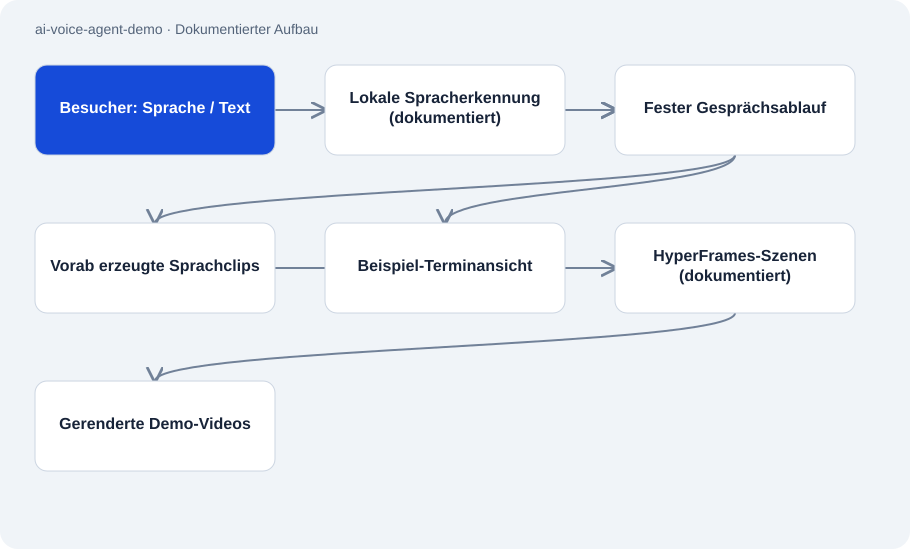

# ai-voice-agent-demo

Öffentlich · Fallstudie · 2026-11-02

Fallstudie und Medienpaket für den Telefonassistenten Alex. Die öffentliche Browserdemo führt Besucher durch einen festen Gesprächsablauf für vier Handwerksbranchen. Vorgefertigte Sprachaufnahmen und Beispieltermine zeigen, wie eine Empfangssituation aussehen kann.

## Zweck

Ein Besucher kann den Ablauf vom ersten Gruß über die Problembeschreibung bis zur Terminbestätigung kennenlernen. Die Fallstudie erklärt außerdem, wie geskriptete Gespräche, synthetische Stimmen und HTML-Szenen zu Demo-Videos zusammengefügt wurden.

## Funktionen

- Vier Branchen: Heizung/Klima, Sanitär, Dach und Solar, jeweils auf Englisch und Deutsch.
- Sprechen oder Tippen, Rücklesen von Kontaktdaten und Auswahl aus drei Beispielzeiten.
- Kurzes Gesprächsvideo, längerer Rundgang und einzelne synthetische Audiobeispiele.
- Dokumentierter Produktionsablauf: Text schreiben, Sprache erzeugen, rücktranskribieren, HTML-Szenen rendern und komprimieren.

## Aufbau

- Die Rezeptionsdemo wählt aus vorher aufgenommenen Antworten. Laut Dokumentation verarbeitet lokale Spracherkennung den gesprochenen Besuchereingang; Tippen bleibt als Alternative verfügbar.
- Der dokumentierte Videoablauf verbindet Text-to-Speech-Clips mit HyperFrames-Szenen. ffmpeg komprimiert die gerenderten Medien.
- Das öffentliche Repository enthält Markdown, Bilder, Audio und Videos. React/Vite-Website und Telnyx-Konfiguration sind hier nicht als ausführbare Anwendung enthalten.

## Stand und Grenzen

- Die öffentliche Rezeptionsdemo nutzt kein live antwortendes Sprachmodell. Sie bucht, versendet und speichert nichts.
- Firmen und Gesprächsdaten sind erfunden; auch die Anruferstimme im Video ist ein Platzhalter.
- Die Beschreibung einer Telefonintegration belegt keinen produktiven Kundeneinsatz. Ein längerer Test mit mehreren echten Sprechern ist laut Dokumentation noch offen.
- Es gibt keinen Installationsbefehl für ein vollständiges Produkt; das Repository ist eine Fallstudie.

## Einstieg

Kein belastbar belegter Startbefehl für diese Repo-Rolle.

## Wichtige Dateien

- `README.md`: Gesprächsablauf, Medien und Herstellungsprozess.
- `docs/reception-demo.md`: Verhalten und Grenzen der geführten Browserdemo.
- `media/call-demo-short.mp4`: Kurzes geskriptetes Gesprächsvideo.
- `audio/de-greeting-hvac.mp3`: Synthetischer deutscher Begrüßungsclip.

## Belege

README, Rezeptionsdokumentation und Medienpfade am 02.11.2026 geprüft. Das Verhalten der Website ist als Dokumentationsaussage gekennzeichnet; Website und Telefonie wurden hier nicht ausgeführt.

- [README.md](https://github.com/Atakan-24/ai-voice-agent-demo/blob/main/README.md)
- [docs/reception-demo.md](https://github.com/Atakan-24/ai-voice-agent-demo/blob/main/docs/reception-demo.md)

## Bilder und Demos

- [Vorschau des geskripteten Gesprächs mit fiktiver Firma.](https://raw.githubusercontent.com/Atakan-24/ai-voice-agent-demo/main/images/short-poster.jpg)
- [Kurzes Gesprächsvideo, laut README 1:37 Minuten.](https://raw.githubusercontent.com/Atakan-24/ai-voice-agent-demo/main/media/call-demo-short.mp4)
- [Verlinkte englische Browserdemo mit festen Antworten und Beispielzeiten.](https://teamgoldllc.de/voice-agent)
- [Verlinkte deutsche Fassung derselben geführten Demo.](https://teamgoldllc.de/voice-agent/de)
