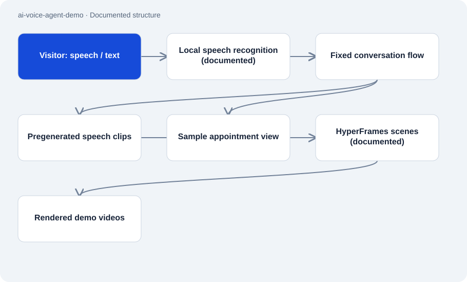

# ai-voice-agent-demo

Public · Case study · 2026-11-02

Case study and media collection for Alex, a telephone assistant. The public browser demo guides visitors through a fixed conversation for four trades. Prerecorded speech and sample appointments illustrate a reception workflow.

## Purpose

Visitors can explore the flow from the greeting through a description of the problem to appointment confirmation. The case study also explains how scripted conversations, synthetic voices and HTML scenes were combined into demo videos.

## Features

- Four trades: heating/air, plumbing, roofing and solar, in English and German.
- Speech or typed input, contact-detail readback and a choice of three sample times.
- Short call video, longer walkthrough and individual synthetic audio examples.
- Documented production process: write scripts, generate speech, transcribe it back, render HTML scenes and compress the result.

## Structure

- The reception demo chooses between prerecorded responses. The documentation describes local speech recognition for visitor input, with typing available as an alternative.
- The documented video process combines text-to-speech clips with HyperFrames scenes. ffmpeg compresses the rendered media.
- The public repository contains Markdown, images, audio and video. The React/Vite website and Telnyx configuration are not included here as an executable application.

## Status and limits

- The public reception demo does not use a live responding language model. It books, sends and stores nothing.
- Businesses and conversation details are fictional; the caller voice in the video is a placeholder too.
- Describing a telephony integration does not establish customer production use. The documentation still lists a longer test with several real speakers as open.
- There is no installation command for a complete product; this repository is a case study.

## Getting started

No substantiated startup command for this repository role.

## Key files

- `README.md`: Conversation flow, media and production process.
- `docs/reception-demo.md`: Behavior and limits of the guided browser demo.
- `media/call-demo-short.mp4`: Short scripted call video.
- `audio/de-greeting-hvac.mp3`: Synthetic German greeting clip.

## Sources

Reviewed the README, reception documentation and media paths on 2 November 2026. Website behavior is identified as a documentation claim; the website and telephony were not exercised here.

- [README.md](https://github.com/Atakan-24/ai-voice-agent-demo/blob/main/README.md)
- [docs/reception-demo.md](https://github.com/Atakan-24/ai-voice-agent-demo/blob/main/docs/reception-demo.md)

## Images and demos

- [Preview of the scripted call with a fictional business.](https://raw.githubusercontent.com/Atakan-24/ai-voice-agent-demo/main/images/short-poster.jpg)
- [Short call video, listed as 1:37 in the README.](https://raw.githubusercontent.com/Atakan-24/ai-voice-agent-demo/main/media/call-demo-short.mp4)
- [Linked English browser demo with fixed replies and sample times.](https://teamgoldllc.de/voice-agent)
- [Linked German version of the same guided demo.](https://teamgoldllc.de/voice-agent/de)
