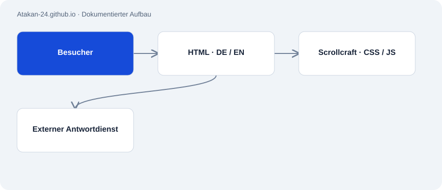

# Atakan-24.github.io

Öffentlich · Anwendung · 2026-11-02

Zweisprachiges Portfolio mit Projektgeschichten, interaktiven Erklärungen und Kontaktmöglichkeiten. Die laufende Überarbeitung richtet den Einstieg auf individuelle Software und mögliche technische Partnerschaften aus.

## Zweck

Technische Arbeit anhand von Beispielen erklären und ein konkretes Projektgespräch ermöglichen.



## Funktionen

- Deutsche und englische Seiten, heller und dunkler Modus.
- Scrollgesteuerte CRM-Darstellung, Bewertungs- und Paginierungsbeispiele.
- Lokale Kurzantworten und ein separater externer Freitext-Chat.
- Im lokalen Entwurf: aktualisierte CRM- und Voice-Fallstudien sowie neues Link-Vorschaubild.
- Im lokalen Entwurf: sechs Projektvorschauen mit Medien und verlinkte DE/EN-Dokumentation der 16 öffentlichen Repos.

## Aufbau

- Statische HTML-Seiten enthalten Inhalt, seitenbezogene CSS-Regeln und JavaScript.
- scrollcraft.css und scrollcraft.js steuern gemeinsame Gestaltung und Scroll-Interaktionen.
- Externe Supabase-Funktionen bedienen Freitext-Antworten und Besucherereignisse; ihr Backend wurde hier nicht geprüft.

## Stand und Grenzen

- Die neue Headline und Korrekturen sind als lokaler Entwurf vorhanden und noch nicht veröffentlicht.
- Externe Chat-Antworten und deren Wissensbasis wurden nicht live geprüft.
- Ein Projektbericht ist keine aktuelle Betriebsanzeige aller beschriebenen Systeme.

## Einstieg

Im Repo-Verzeichnis als lokale statische Vorschau starten. Im aktuellen Entwurf sind lokale Analytics abgeschaltet.

```sh
python3 -m http.server 8765 --bind 127.0.0.1
```

## Wichtige Dateien

- `index.html`: Englische Seite und lokale Interaktionen.
- `de/index.html`: Deutsche Ausgabe.
- `scrollcraft.js`: Scroll- und Bewegungssystem.
- `scrollcraft.css`: Gemeinsame Gestaltungsregeln.
- `og.jpg`: Vorschaubild für geteilte Links.
- `project-media.css / project-media.js`: Lokaler Entwurf: Darstellung und kontrollierte Wiedergabe der Projektmedien.
- `projects/`: Lokaler Entwurf: Dokumentation und Grafiken ausschließlich öffentlicher Repos.

## Belege

Öffentlichen Quellcode bei Commit 406ab7b geprüft. Lokalen Entwurf auf zehn Kombinationen aus Sprache und Bildschirmbreite sowie Interaktionen getestet.

- [Portfolio source](https://github.com/Atakan-24/Atakan-24.github.io)
- [Live portfolio](https://atakan-24.github.io/)

## Bilder und Demos

- [Lokale Desktop-Vorschau des überarbeiteten Entwurfs, 02.11.2026.](../assets/portfolio-draft.png)
- [Aktuell veröffentlichte Seite; kann vom Entwurf abweichen.](https://atakan-24.github.io/)
