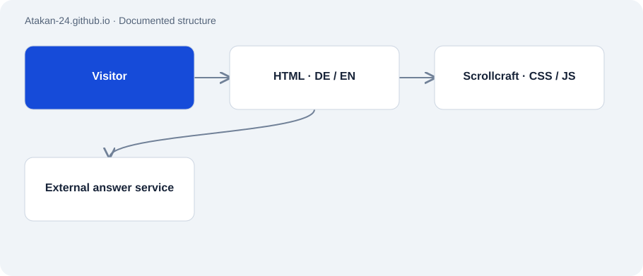

# Atakan-24.github.io

Public · Application · 2026-11-02

A bilingual portfolio with project stories, interactive explanations and contact channels. The pending refresh introduces custom software and potential technical partnerships.

## Purpose

Explain engineering work through examples and enable a practical project conversation.



## Features

- German and English editions, light and dark modes.
- Scroll-driven CRM illustration, scoring and pagination examples.
- Local quick answers plus a separate external free-text chat.
- The local draft adds updated CRM and voice case studies and a new sharing image.
- The local draft includes six project previews with media and linked DE/EN documentation for the 16 public repositories.

## Structure

- Static HTML pages contain content, page-specific CSS and JavaScript.
- scrollcraft.css and scrollcraft.js provide shared styling and scroll interactions.
- External Supabase functions serve free-text answers and visitor events; their backend was not reviewed here.

## Status and limits

- The new headline and corrections exist as a local draft and have not been published.
- External chat answers and their knowledge base were not live-tested.
- Project stories are not a current uptime report for every described system.

## Getting started

Run from the repository directory for a local static preview. The current draft disables local analytics.

```sh
python3 -m http.server 8765 --bind 127.0.0.1
```

## Key files

- `index.html`: English page and local interactions.
- `de/index.html`: German edition.
- `scrollcraft.js`: Scroll and motion system.
- `scrollcraft.css`: Shared visual rules.
- `og.jpg`: Sharing preview image.
- `project-media.css / project-media.js`: Local draft: project-media layout and controlled playback.
- `projects/`: Local draft: documentation and diagrams for public repositories only.

## Sources

Public source at commit 406ab7b inspected. The local draft was tested across ten language/viewport combinations and interactive flows.

- [Portfolio source](https://github.com/Atakan-24/Atakan-24.github.io)
- [Live portfolio](https://atakan-24.github.io/)

## Images and demos

- [Local desktop preview of the refreshed draft, 2 Nov 2026.](../assets/portfolio-draft.png)
- [Currently published page; it may differ from the draft.](https://atakan-24.github.io/)
