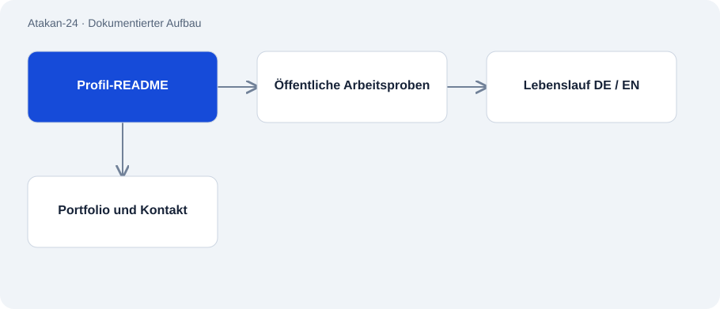

# Atakan-24

Öffentlich · Kontext / Dokumentation · 2026-11-02

Das öffentliche GitHub-Profil verbindet Arbeitsproben, Lebenslauf und Kontaktwege. Es ist der Einstieg in die Projektsammlung, keine eigenständige Softwareanwendung.

## Zweck

Entwicklern und möglichen Projektpartnern einen überprüfbaren Überblick über Atakans Arbeit geben.

## Funktionen

- Verweise auf CRM-Fallstudie, Entwicklerwerkzeuge, Sprachmodell-Experimente und Voice-Demo.
- Lebenslauf und Ziele in deutscher und englischer Fassung.
- Links zu Portfolio und TEAM GOLD.

## Aufbau

- GitHub rendert die README des gleichnamigen Profil-Repositories.
- Dokumente und verlinkte Repos liefern die eigentlichen Arbeitsproben.

## Stand und Grenzen

- Profilangaben sind Selbstauskünfte; Funktionen und Ergebnisse müssen am verlinkten Projekt belegt werden.
- Die Anzahl verlinkter Repos ist kein Nachweis für ebenso viele unabhängige produktive Anwendungen.

## Einstieg

Kein belastbar belegter Startbefehl für diese Repo-Rolle.

## Wichtige Dateien

- `README.md`: Profiltext und Projektindex.
- `CV_Atakan_Ismail_Oeztunc_EN.md`: Englischer Lebenslauf.
- `Lebenslauf_Atakan_Ismail_Oeztunc_DE.md`: Deutscher Lebenslauf.

## Belege

Profil-README und verlinkte Arbeitsproben gelesen; keine unabhängige Bestätigung von Kundenergebnissen.

- [Profile README](https://github.com/Atakan-24/Atakan-24/blob/main/README.md)
- [GitHub profile](https://github.com/Atakan-24)

## Bilder und Demos

- [Öffentliches GitHub-Profil öffnen.](https://github.com/Atakan-24)
