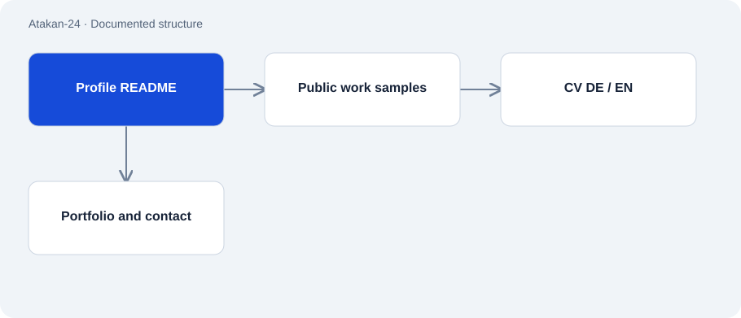

# Atakan-24

Public · Context / documentation · 2026-11-02

The public GitHub profile connects work samples, a CV and contact channels. It is the entry point to the project collection, rather than a standalone application.

## Purpose

Give developers and potential project partners a verifiable overview of Atakan’s work.

## Features

- Links to the CRM case study, developer tools, language-model experiments and voice demo.
- CV and goals in German and English.
- Links to the portfolio and TEAM GOLD.

## Structure

- GitHub renders the README from the repository matching the account name.
- Documents and linked repositories provide the actual work samples.

## Status and limits

- Profile statements are self-reported; linked projects must substantiate functions and results.
- The number of linked repositories is not evidence of the same number of independent production applications.

## Getting started

No substantiated startup command for this repository role.

## Key files

- `README.md`: Profile copy and project index.
- `CV_Atakan_Ismail_Oeztunc_EN.md`: English CV.
- `Lebenslauf_Atakan_Ismail_Oeztunc_DE.md`: German CV.

## Sources

Profile README and linked work samples inspected; no independent verification of customer outcomes.

- [Profile README](https://github.com/Atakan-24/Atakan-24/blob/main/README.md)
- [GitHub profile](https://github.com/Atakan-24)

## Images and demos

- [Open the public GitHub profile.](https://github.com/Atakan-24)
