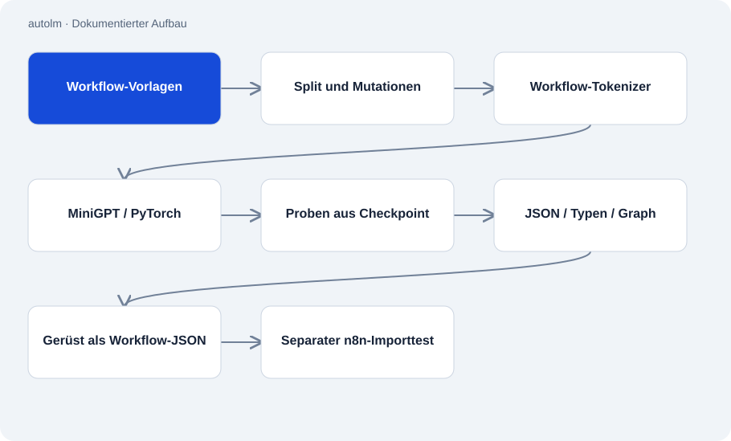

# autolm

Öffentlich · Forschung / Experiment · 2026-11-02

Experiment zum Bau eines kleinen Sprachmodells von Grund auf. Das Repository verbindet Lehrschritte für Backpropagation und Attention mit einem PyTorch-Transformer, BPE-Tokenizer, Training und einer messbaren Aufgabe: n8n-Workflow-Gerüste aus Text erzeugen.

## Zweck

Die Arbeit untersucht, welche Teile einer engen Generierungsaufgabe ein kleines eigenes Modell lernen kann. Statt nur Textproben zu zeigen, prüft sie JSON, bekannte Knotentypen, Verbindungen und den Import in n8n. Eine einfache Nachschlagekontrolle dient als Vergleich.



## Funktionen

- Lehrpfad und fusionierter QKV-Attention-Pfad mit Gleichheitstests.
- Datenaufbereitung, eigenes BPE, Checkpointing und Trainingsschleife.
- Vorlagensplits mit Abbruch bei überlappenden IDs oder identischen Testtexten im Training.
- Versionierte Auswertungsdateien und lokale Demo mit offen ausgewiesenem Best-of-k.

## Aufbau

- Öffentliche Vorlagen werden in Kurzschrift überführt und für das Training mutiert. Ein eigener Tokenizer erzeugt die Eingabeströme für MiniGPT.
- Die Demo lädt vorhandene Checkpoints, zieht Modellproben, prüft lokale Tore und rendert lesbare Ausgaben zu Workflow-JSON. Der separate Importprüfer ruft n8n auf.
- Gespeicherte Ergebnisse vom 12.09.2026 melden für 15 Aufgaben 7/15 gültige Antworten bei einem Versuch und 15/15 mit Best-of-8. Das sind Ergebnisse dieses Versuchsaufbaus.

## Stand und Grenzen

- Checkpoints und abgeleitete Trainingsdaten sind nicht enthalten. Eine frische Kopie kann die trainierte Demo nicht sofort starten.
- Importierbare Gerüste enthalten noch keine vollständigen Parameter und belegen keine fachlich korrekte Automation.
- Best-of-8 ist kein fairer Ein-Versuch-Vergleich. Laut README bleibt das Modell bei semantischer Übereinstimmung unter der Nachschlagekontrolle.
- GPU-Training und weitere Forschungsstufen sind im dokumentierten Stand offen. Historische Modellnamen, Preise und Ergebnisse im README sind keine aktuelle Marktübersicht.

## Einstieg

Reiner Python-Lehrschritt zur automatischen Ableitung. Das trainierte Workflow-Modell benötigt weitere Daten und Abhängigkeiten.

```sh
python schritte/01_wie_lernt_ein_computer.py
```

Dokumentierter Testaufruf; die vorhandene Python-Umgebung und benötigte Bibliotheken müssen vorher eingerichtet sein.

```sh
python -m unittest workflow.test_workflow
```

## Wichtige Dateien

- `kern/modell.py`: MiniGPT und die beiden Attention-Pfade.
- `workflow/baue_datensatz.py`: Vorlagensplits, Mutationen und Tokenströme.
- `workflow/demo.py`: Lokale Proben aus vorhandenen Checkpoints.
- `bewertung/tore.py`: JSON-, Typen- und Graphprüfungen.
- `bewertung/ergebnisse/`: Gespeicherte Resultate einzelner Versuche.

## Belege

README, Modell, Datensatzbauer, Demo, lokale Prüfungen und zwei gespeicherte Resultate am 02.11.2026 gelesen. Ergebnisse wurden aus den JSON-Dateien abgelesen; kein Training, Provideraufruf oder n8n-Import wurde wiederholt.

- [README.md](https://github.com/Atakan-24/autolm/blob/master/README.md)
- [kern/modell.py](https://github.com/Atakan-24/autolm/blob/master/kern/modell.py)
- [workflow/demo.py](https://github.com/Atakan-24/autolm/blob/master/workflow/demo.py)
- [workflow/baue_datensatz.py](https://github.com/Atakan-24/autolm/blob/master/workflow/baue_datensatz.py)
- [bewertung/tore.py](https://github.com/Atakan-24/autolm/blob/master/bewertung/tore.py)
- [bewertung/ergebnisse/stufe4-v3-15instr-tor4-k1-2026-09-12.json](https://github.com/Atakan-24/autolm/blob/master/bewertung/ergebnisse/stufe4-v3-15instr-tor4-k1-2026-09-12.json)
- [bewertung/ergebnisse/stufe4-v3-15instr-tor4-k8-2026-09-12.json](https://github.com/Atakan-24/autolm/blob/master/bewertung/ergebnisse/stufe4-v3-15instr-tor4-k8-2026-09-12.json)

## Bilder und Demos

Die Struktur-Grafik oben stellt den belegten Aufbau dar; es wird kein laufendes UI vorgetäuscht.
