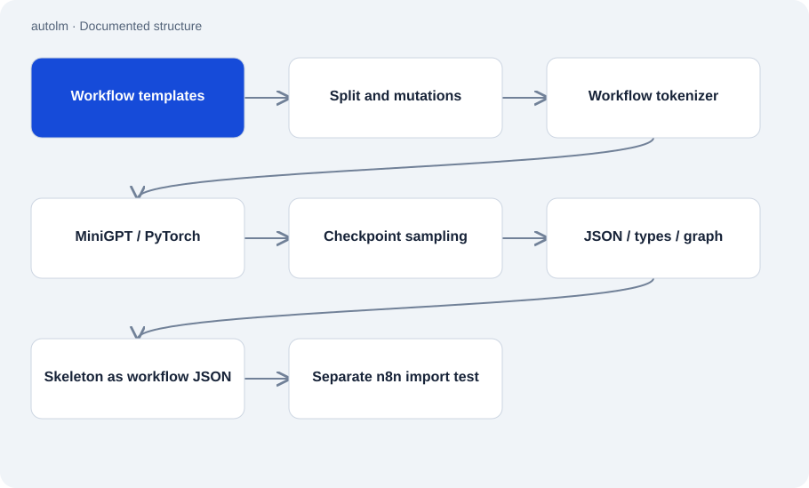

# autolm

Public · Research / experiment · 2026-11-02

Experiment in building a small language model from scratch. The repository connects lessons on backpropagation and attention with a PyTorch transformer, BPE tokenizer, training code and a measurable task: producing n8n workflow skeletons from text.

## Purpose

The work examines which parts of a narrow generation task a small custom model can learn. Evaluation checks JSON, known node types, connections and n8n import rather than relying on text samples alone. A simple retrieval baseline supplies a comparison.



## Features

- Teaching implementation and fused QKV attention path with equivalence tests.
- Data preparation, custom BPE, checkpoint handling and training loop.
- Template splits that stop on overlapping IDs or test text duplicated in training.
- Versioned evaluation results and a local demo that explicitly reports best-of-k sampling.

## Structure

- Public templates become a shorthand representation and are mutated for training. A custom tokenizer creates input streams for MiniGPT.
- The demo loads existing checkpoints, samples the model, applies local checks and renders readable outputs as workflow JSON. A separate import checker invokes n8n.
- Stored results dated 12 September 2026 report 7/15 valid answers with one attempt and 15/15 with best-of-8 on 15 tasks. These are results from that experimental setup.

## Status and limits

- Checkpoints and derived training data are excluded. A fresh checkout cannot immediately run the trained demo.
- Importable skeletons still lack complete parameters and do not establish semantically correct automation.
- Best-of-8 is not an equal single-attempt comparison. The README reports that semantic agreement remains below the retrieval baseline.
- GPU training and later research stages remain open in the documented snapshot. Historical model names, prices and results in the README are not a current market comparison.

## Getting started

Pure Python lesson on automatic differentiation. The trained workflow model needs additional data and dependencies.

```sh
python schritte/01_wie_lernt_ein_computer.py
```

Documented test command; the Python environment and required libraries must already be available.

```sh
python -m unittest workflow.test_workflow
```

## Key files

- `kern/modell.py`: MiniGPT and its two attention implementations.
- `workflow/baue_datensatz.py`: Template splits, mutations and token streams.
- `workflow/demo.py`: Local sampling from existing checkpoints.
- `bewertung/tore.py`: JSON, type and graph validation.
- `bewertung/ergebnisse/`: Stored results from individual experiments.

## Sources

Read the README, model, dataset builder, demo, local checks and two stored result files on 2 November 2026. Results were read from JSON; training, provider calls and n8n imports were not repeated.

- [README.md](https://github.com/Atakan-24/autolm/blob/master/README.md)
- [kern/modell.py](https://github.com/Atakan-24/autolm/blob/master/kern/modell.py)
- [workflow/demo.py](https://github.com/Atakan-24/autolm/blob/master/workflow/demo.py)
- [workflow/baue_datensatz.py](https://github.com/Atakan-24/autolm/blob/master/workflow/baue_datensatz.py)
- [bewertung/tore.py](https://github.com/Atakan-24/autolm/blob/master/bewertung/tore.py)
- [bewertung/ergebnisse/stufe4-v3-15instr-tor4-k1-2026-09-12.json](https://github.com/Atakan-24/autolm/blob/master/bewertung/ergebnisse/stufe4-v3-15instr-tor4-k1-2026-09-12.json)
- [bewertung/ergebnisse/stufe4-v3-15instr-tor4-k8-2026-09-12.json](https://github.com/Atakan-24/autolm/blob/master/bewertung/ergebnisse/stufe4-v3-15instr-tor4-k8-2026-09-12.json)

## Images and demos

The structure diagram above presents the evidenced components; it does not pretend to show a running UI.
