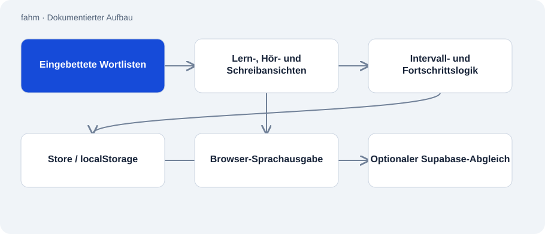

# fahm

Öffentlich · Anwendung · 2026-11-02

Persönliche Lernanwendung für arabische Wörter und Sätze mit deutscher Oberfläche. HTML, CSS, Wortlisten und JavaScript stehen gemeinsam in fahm.html. Der aktuelle Quelltext verbindet wiederholte Abfragen, Hörübungen und eigene Satzsammlungen.

## Zweck

Die Anwendung ergänzt das Lernen aus einem Lehrbuch um regelmäßiges Abrufen von Vokabeln. Häufige Quran-Wörter und ein gesonderter Sprechwortschatz helfen bei unterschiedlichen Lernzielen. Beispiel­sätze, Umschrift und eigene Merkhilfen begleiten die Einträge.

## Funktionen

- Wiederholung nach festen Tagesintervallen und getrennte Abfrage auf Arabisch.
- Hörmodus mit Browser-Sprachausgabe sowie Schreib- und eigene Vokabelansichten.
- Häufigkeitssortierung mit bevorzugten Funktionswörtern und Anzeige des Lernfortschritts.
- Eigene Sprachinseln und optionaler Abgleich über selbst eingetragene Supabase-Daten.

## Aufbau

- Sechs eingebettete Rohlisten werden zu Wortobjekten aufbereitet. Ihre statischen Zeilen ergeben im geprüften Stand 546 Einträge; die README-Angabe von 353 ist älter.
- Ein Store kapselt localStorage und merkt, ob dauerhaftes Speichern verfügbar ist. Ohne Speicherzugriff arbeitet die Anwendung mit dem Speicherzustand der Sitzung weiter.
- Die Sync-Komponente bleibt ohne eigene URL, Schlüssel und Abgleichcode inaktiv. Browser-Sprachausgabe hat Auswahl- und Timeoutlogik für Stimmen.

## Stand und Grenzen

- Im aktuellen Repository sind keine Manifestdatei und keine Service-Worker-Registrierung erkennbar. Die README-Aussage zur Offline-PWA ist damit nicht belegt.
- Browserstimmen und iOS-Verhalten hängen von der Umgebung ab; hier wurde kein Gerätetest ausgeführt.
- Lokaler Fortschritt hängt von verfügbaren Browserdaten ab. Geräteübergreifender Abgleich benötigt eine eigene Supabase-Einrichtung.
- Es gibt keinen Build-Schritt und keinen Serverstart; der dokumentierte Einstieg ist das Öffnen der HTML-Datei.

## Einstieg

Kein belastbar belegter Startbefehl für diese Repo-Rolle.

## Wichtige Dateien

- `fahm.html`: Gesamte Anwendung samt Wortlisten, Speicher, Ansichten und optionalem Abgleich. Zum lokalen Einstieg herunterladen und im Browser öffnen.
- `README.md`: Lernmethode und technische Beschreibung mit teilweise älteren Angaben.

## Belege

README, vollständige Dateiliste und fahm.html am 02.11.2026 statisch geprüft. Die 546 Einträge wurden aus Rohtextzeilen gezählt. Eine separate passive Bildschirmaufnahme zeigt die öffentliche Webfassung; ihre Gleichheit mit dem Quellstand ist nicht belegt. Offline- und Lernerfolgsversprechen wurden nicht übernommen.

- [README.md](https://github.com/Atakan-24/fahm/blob/main/README.md)
- [fahm.html](https://github.com/Atakan-24/fahm/blob/main/fahm.html)
- [Passive browser capture, 2026-11-02](https://fahm-web.vercel.app/)

## Bilder und Demos

- [Passive Aufnahme der öffentlichen Fahm-Webseite vom 02.11.2026. Kein Nachweis, dass der gezeigte Deployment-Stand dem Standardbranch entspricht.](../assets/fahm-current.png)
- [Im README verlinkte Webfassung.](https://fahm-web.vercel.app)
