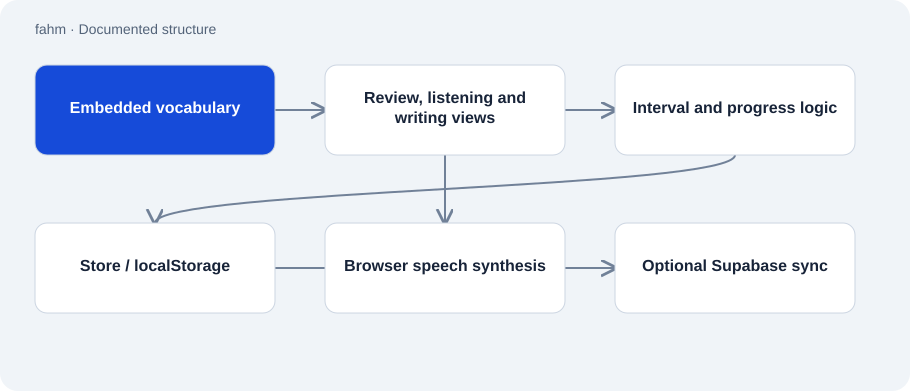

# fahm

Public · Application · 2026-11-02

Personal learning application for Arabic words and sentences with a German interface. HTML, CSS, vocabulary and JavaScript live together in fahm.html. The current source combines scheduled review, listening practice and custom sentence collections.

## Purpose

The application supplements textbook study with regular vocabulary recall. Frequent Quran vocabulary and a separate speaking set support different learning goals. Example sentences, transliteration and personal memory aids accompany the entries.

## Features

- Review using fixed day intervals and a separate Arabic recall direction.
- Listening mode using browser speech synthesis, writing practice and custom vocabulary views.
- Frequency ordering with function-word priority and learning-progress display.
- Custom language islands and optional synchronization using user-supplied Supabase settings.

## Structure

- Six embedded raw lists become vocabulary objects. Their static rows total 546 entries in the reviewed source; the README’s count of 353 is older.
- A Store wraps localStorage and tracks whether persistent storage is available. Without storage access, the application continues with in-session memory.
- The sync component stays inactive without a user-supplied URL, key and sync code. Browser speech synthesis has voice selection and timeout handling.

## Status and limits

- The current repository shows no manifest file or service-worker registration. Its README claim of an offline PWA is therefore unsubstantiated by this source.
- Browser voices and iOS behavior depend on the environment; no device test was performed here.
- Local progress depends on available browser storage. Cross-device sync requires a separate Supabase setup.
- There is no build step or server startup; the documented entry point is opening the HTML file.

## Getting started

No substantiated startup command for this repository role.

## Key files

- `fahm.html`: Complete application with vocabulary, storage, views and optional sync. Download and open in a browser for local use.
- `README.md`: Learning method and technical description containing some older claims.

## Sources

Statically reviewed the README, complete file list and fahm.html on 2 November 2026. The 546 entries were counted from raw text rows. A separate passive capture shows the public web version; parity with the source snapshot is unverified. Offline and learning-outcome promises were not adopted.

- [README.md](https://github.com/Atakan-24/fahm/blob/main/README.md)
- [fahm.html](https://github.com/Atakan-24/fahm/blob/main/fahm.html)
- [Passive browser capture, 2026-11-02](https://fahm-web.vercel.app/)

## Images and demos

- [Passive capture of the public Fahm website on 2 November 2026. This does not establish that the deployed version matches the default branch.](../assets/fahm-current.png)
- [Web version linked in the README.](https://fahm-web.vercel.app)
