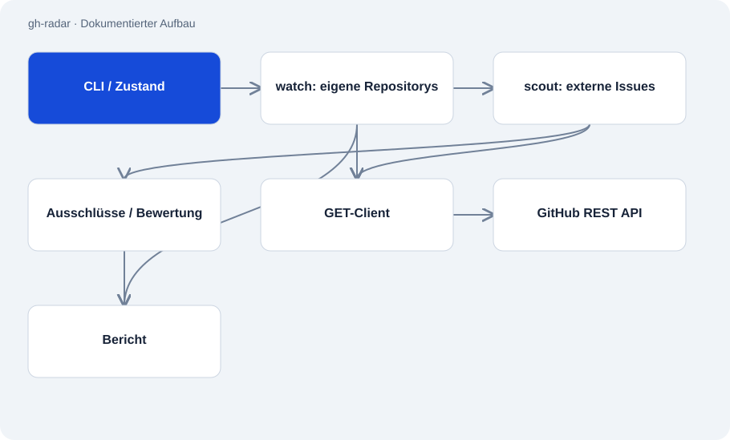

# gh-radar

Öffentlich · Werkzeug · 2026-11-02

Python-Digest für GitHub-Aktivität: offene Rückfragen in eigenen Repositorys und begründete Vorschläge für Beiträge in anderen Projekten. Das Werkzeug liest GitHub und schreibt einen Bericht. Die HTTP-Schicht lehnt andere Methoden als GET ab.

## Zweck

Der Bericht soll übersehene Rückfragen sichtbar machen und eine große Issue-Suche auf wenige passende Kandidaten reduzieren. Menschen entscheiden anschließend, ob und wie sie tätig werden. Zustand zwischen Läufen verhindert ständig wiederholte Vorschläge.



## Funktionen

- Eigene Repositorys beobachten und externe Issues nach Ausschlüssen bewerten.
- Jeder Vorschlag enthält Gründe, Warnungen und eine einfache Aufwandsklasse.
- Sprachen aus zugänglichen Repositorys erkennen oder per Option festlegen.
- Text-, JSON- und vollständig netzloser Dry-run-Modus.

## Aufbau

- __main__.py orchestriert watch und scout, verwaltet Zustand und übergibt Ergebnisse an report.py.
- Netzwerkzugriffe laufen über github.py. Der Request-Einstieg akzeptiert nur GET und behandelt Drosselung getrennt von leeren Ergebnissen.
- score.py trennt harte Ausschlüsse von gewichteten Heuristiken. Die Dokumentation meldet 58 Tests; diese Prüfung hat sie nicht ausgeführt.

## Stand und Grenzen

- Gewichte und Aufwandshinweise sind Heuristiken. Sie sagen keinen Merge oder Projektnutzen voraus.
- Die Suche konzentriert sich auf gelabelte Issues und ist durch Tokenrechte und GitHub-Quoten begrenzt.
- Das Werkzeug öffnet keine PRs und beantwortet keine Issues. Zeitplanung und Benachrichtigungsversand gehören nicht zum Kern.

## Einstieg

Rendert die im Code enthaltenen Beispieldaten ohne Netzwerk oder GitHub-Token.

```sh
python -m radar --dry-run
```

Liest GitHub mit einem zuvor gesetzten GH_RADAR_TOKEN, GITHUB_TOKEN oder GH_TOKEN; Token niemals in den Befehl schreiben.

```sh
python -m radar
```

## Wichtige Dateien

- `radar/__main__.py`: CLI, Zustand und Orchestrierung.
- `radar/github.py`: GET-Client und Drosselungsfehler.
- `radar/score.py`: Ausschlüsse, Gewichte und Begründungen.
- `radar/report.py`: Im Architekturplan getrennte Berichtsausgabe.

## Belege

README, CLI, HTTP-Client und Scoringmodul am 02.11.2026 gelesen. GET-Beschränkung ist im ausgewählten Quellcode sichtbar. Keine Live-Suche, Nachrichten oder Änderungen an GitHub ausgeführt.

- [README.md](https://github.com/Atakan-24/gh-radar/blob/main/README.md)
- [radar/github.py](https://github.com/Atakan-24/gh-radar/blob/main/radar/github.py)
- [radar/__main__.py](https://github.com/Atakan-24/gh-radar/blob/main/radar/__main__.py)
- [radar/score.py](https://github.com/Atakan-24/gh-radar/blob/main/radar/score.py)

## Bilder und Demos

- [Veröffentlichter Beispieldigest mit erfundenen Namen.](https://raw.githubusercontent.com/Atakan-24/gh-radar/main/demo.svg)
