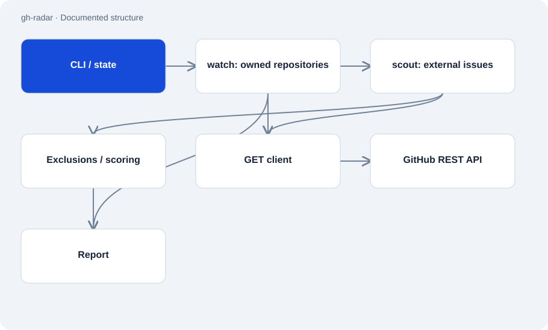

# gh-radar

Public · Tool · 2026-11-02

Python digest of GitHub activity: outstanding questions in owned repositories and explained contribution suggestions elsewhere. The tool reads GitHub and produces a report. Its HTTP layer rejects methods other than GET.

## Purpose

The digest aims to surface missed questions and reduce broad issue searches to a few suitable candidates. People then decide whether and how to act. State between runs prevents constant repetition of suggestions.



## Features

- Watch owned repositories and score external issues after hard exclusions.
- Suggestions carry reasons, warnings and a simple effort category.
- Detect languages from accessible repositories or override them with an option.
- Text, JSON and fully offline dry-run modes.

## Structure

- __main__.py orchestrates watch and scout, maintains state and passes results to report.py.
- Network access goes through github.py. Its request entry point accepts only GET and separates rate limiting from empty results.
- score.py separates hard exclusions from weighted heuristics. The documentation reports 58 tests; this review did not run them.

## Status and limits

- Weights and effort hints are heuristics. They do not predict merges or project impact.
- Search focuses on labelled issues and is limited by token permissions and GitHub quotas.
- The tool does not open PRs or answer issues. Scheduling and notification delivery are outside its core.

## Getting started

Renders the sample data included in the source without network access or a GitHub token.

```sh
python -m radar --dry-run
```

Reads GitHub using a previously configured GH_RADAR_TOKEN, GITHUB_TOKEN or GH_TOKEN; do not put a token in the command.

```sh
python -m radar
```

## Key files

- `radar/__main__.py`: CLI, state and orchestration.
- `radar/github.py`: GET client and rate-limit errors.
- `radar/score.py`: Exclusions, weights and explanations.
- `radar/report.py`: Report rendering separated in the architecture.

## Sources

Read the README, CLI, HTTP client and scoring module on 2 November 2026. The GET restriction is visible in the selected source. No live search, messages or GitHub changes were performed.

- [README.md](https://github.com/Atakan-24/gh-radar/blob/main/README.md)
- [radar/github.py](https://github.com/Atakan-24/gh-radar/blob/main/radar/github.py)
- [radar/__main__.py](https://github.com/Atakan-24/gh-radar/blob/main/radar/__main__.py)
- [radar/score.py](https://github.com/Atakan-24/gh-radar/blob/main/radar/score.py)

## Images and demos

- [Published example digest using invented names.](https://raw.githubusercontent.com/Atakan-24/gh-radar/main/demo.svg)
