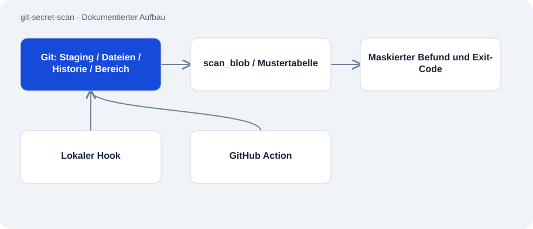

# git-secret-scan

Öffentlich · Werkzeug · 2026-11-02

Python-Werkzeug zum Erkennen bekannter Zugangsdatenmuster vor einem Git-Commit. Derselbe Scanner kann lokale Dateien, Historie und Änderungen zwischen Revisionen prüfen. Ein Hook und eine GitHub Action verbinden ihn mit Entwicklungsabläufen.

## Zweck

Der Scanner entstand nach einem dokumentierten Fund von Zugangsdaten in verfolgten Dateien. Er soll bekannte Muster früh sichtbar machen und den Commit oder CI-Lauf bei einem Fund stoppen. Ausgaben maskieren den erkannten Wert.



## Funktionen

- Zehn Musterarten, keine Laufzeitpakete außerhalb der Python-Standardbibliothek.
- Prüfung des Staging-Bereichs, verfolgter Dateien, der Historie oder eines Revisionsbereichs.
- Bewusste Platzhalter- und Opt-out-Behandlung sowie maskierte Befunde.
- Beschrifteter 61-Fälle-Benchmark und dokumentierte Regressionstests.

## Aufbau

- Git-Quellen liefern Dateiname und Bytes an scan_blob. Die Mustertabelle trennt Erkennung und textabhängige Ausnahmen.
- install.py erzeugt einen lokalen pre-commit-Hook mit festem Interpreterpfad. action.yml ruft denselben Scanner aus CI auf.
- Das README meldet 98 Tests und 98 % Coverage. Der eigene Benchmark stieg von 80 % Recall und 91,4 % Präzision auf jeweils 100 %.

## Stand und Grenzen

- 100 % beziehen sich auf den selbst geschriebenen Testsatz; unbekannte Muster und alle Geheimnisse werden damit nicht abgedeckt.
- Ein Hook wirkt nur dort, wo er installiert ist, und lässt sich überspringen. CI muss separat eingerichtet werden.
- Funde erfordern eine menschliche Prüfung und gegebenenfalls Rotation. Das Werkzeug widerruft keine Zugangsdaten.

## Einstieg

Liest verfolgte Dateien des aktuellen Repositorys; gibt 0, 1 oder 2 für sauber, Fund oder Fehler zurück.

```sh
python scan.py --tracked
```

Führt den mitgelieferten synthetischen Benchmark aus.

```sh
python benchmark/measure.py
```

## Wichtige Dateien

- `scan.py`: Muster, Maskierung und Git-Quellen.
- `install.py`: Lokaler Hook-Installer.
- `action.yml`: Composite Action mit Änderungsmodus.
- `benchmark/measure.py`: Dokumentierter Benchmark-Einstieg.

## Belege

README, Scanner, Hook-Installer und Action am 02.11.2026 gelesen. Testzahlen und Messwerte stammen aus der Dokumentation; dieses Audit hat weder fremde Repositorys gescannt noch Tests wiederholt.

- [README.md](https://github.com/Atakan-24/git-secret-scan/blob/main/README.md)
- [scan.py](https://github.com/Atakan-24/git-secret-scan/blob/main/scan.py)
- [install.py](https://github.com/Atakan-24/git-secret-scan/blob/main/install.py)
- [action.yml](https://github.com/Atakan-24/git-secret-scan/blob/main/action.yml)

## Bilder und Demos

- [Veröffentlichtes schematisches Beispiel eines blockierten Commits.](https://raw.githubusercontent.com/Atakan-24/git-secret-scan/main/demo.svg)
