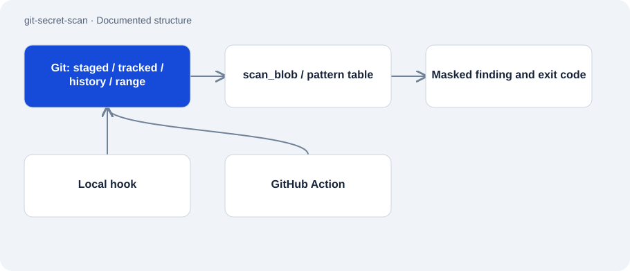

# git-secret-scan

Public · Tool · 2026-11-02

Python tool for detecting known credential patterns before a Git commit. The same scanner can inspect local files, history and changes between revisions. A hook and a GitHub Action connect it to development workflows.

## Purpose

The scanner followed a documented discovery of credentials in tracked files. It aims to surface known patterns early and stop a commit or CI run when it finds one. Output masks the detected value.



## Features

- Ten pattern types and no runtime packages beyond Python’s standard library.
- Scanning of staged files, tracked files, history or a revision range.
- Explicit placeholder and opt-out handling, with masked findings.
- Labelled 61-case benchmark and documented regression tests.

## Structure

- Git sources feed filenames and bytes into scan_blob. The pattern table separates detection from text-dependent exceptions.
- install.py creates a local pre-commit hook with a fixed interpreter path. action.yml invokes the same scanner from CI.
- The README reports 98 tests and 98% coverage. Its own benchmark improved from 80% recall and 91.4% precision to 100% for both.

## Status and limits

- 100% refers to the author’s own corpus; it does not cover unknown patterns or every secret.
- A hook works only where installed and can be bypassed. CI needs separate configuration.
- Findings require human review and, where necessary, credential rotation. The tool does not revoke credentials.

## Getting started

Reads tracked files in the current repository; returns 0, 1 or 2 for clean, finding or error.

```sh
python scan.py --tracked
```

Runs the included synthetic benchmark.

```sh
python benchmark/measure.py
```

## Key files

- `scan.py`: Patterns, masking and Git sources.
- `install.py`: Local hook installer.
- `action.yml`: Composite Action with change scanning.
- `benchmark/measure.py`: Documented benchmark entry point.

## Sources

Read the README, scanner, hook installer and Action on 2 November 2026. Test counts and measurements come from documentation; this audit neither scanned other repositories nor reran tests.

- [README.md](https://github.com/Atakan-24/git-secret-scan/blob/main/README.md)
- [scan.py](https://github.com/Atakan-24/git-secret-scan/blob/main/scan.py)
- [install.py](https://github.com/Atakan-24/git-secret-scan/blob/main/install.py)
- [action.yml](https://github.com/Atakan-24/git-secret-scan/blob/main/action.yml)

## Images and demos

- [Published schematic example of a blocked commit.](https://raw.githubusercontent.com/Atakan-24/git-secret-scan/main/demo.svg)
