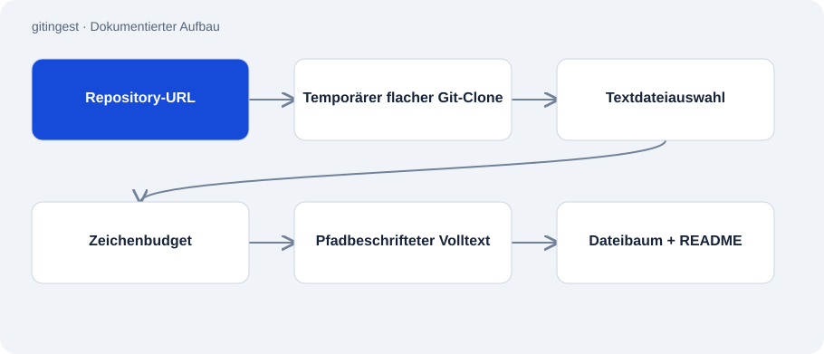

# gitingest

Öffentlich · Werkzeug · 2026-11-02

Kompaktes Python-Skript, das ausgewählte Textdateien eines Git-Repositorys zu einer durchsuchbaren Ausgabe verbindet. Es versieht Inhalte mit relativen Dateipfaden und wechselt bei überschrittenem Zeichenbudget auf eine sichtbare Strukturübersicht.

## Zweck

Eine einzelne Textausgabe erleichtert das Lesen einer Codebasis oder das Bereitstellen von Kontext für Architekturfragen. Das Skript trifft eine Dateiauswahl, erzeugt aber keine Zusammenfassung oder Bewertung des Projekts.



## Funktionen

- Akzeptiert Repository-Kurzname oder URL und klont mit --depth 1.
- Schließt bekannte generierte Verzeichnisse, Binärdateien und Lockfiles aus der Ausgabe aus.
- Berücksichtigt wichtige Dateien ohne Endung, etwa README und Makefile.
- Schreibt nach stdout oder in eine angegebene Datei.

## Aufbau

- gitingest.py nutzt ausschließlich die Standardbibliothek und den installierten Git-Befehl. Ein temporäres Verzeichnis hält den flachen Checkout.
- Dateisammlung und Textaufbau sind getrennte Funktionen. Überschreitet ein Block das Budget, liefert _fallback Dateibaum und README statt eines abgeschnittenen Dumps.

## Stand und Grenzen

- Es gibt keine Inhaltsbewertung, Geheimnisbereinigung oder vollständige Analyse aller Dateien.
- Die Fallback-Ausgabe mit README ist keine harte Garantie, dass das gesamte Ergebnis innerhalb des Zeichenbudgets bleibt.
- Private Zugriffe hängen von vorhandener Git-Anmeldung ab. Keine Cache- oder inkrementelle Aktualisierungsschicht enthalten.
- Dateifilter schließen Inhalte aus der Ausgabe aus; sie ersetzen keine Prüfung der Ausgabe vor ihrer Weitergabe.

## Einstieg

Beobachtetes Beispiel: liest ein öffentliches Repository über einen temporären flachen Clone. Git muss installiert sein.

```sh
python gitingest.py octocat/Hello-World
```

## Wichtige Dateien

- `gitingest.py`: Clone, Auswahl, Textaufbau und Budget-Fallback.
- `tests/test_selection.py`: Im Repository vorhandene Auswahltests.

## Belege

README und gesamtes gitingest.py am 02.11.2026 gelesen. Das Skript wurde nicht ausgeführt und kein fremder Quellcode für diese Prüfung geklont.

- [README.md](https://github.com/Atakan-24/gitingest/blob/main/README.md)
- [gitingest.py](https://github.com/Atakan-24/gitingest/blob/main/gitingest.py)

## Bilder und Demos

Die Struktur-Grafik oben stellt den belegten Aufbau dar; es wird kein laufendes UI vorgetäuscht.
