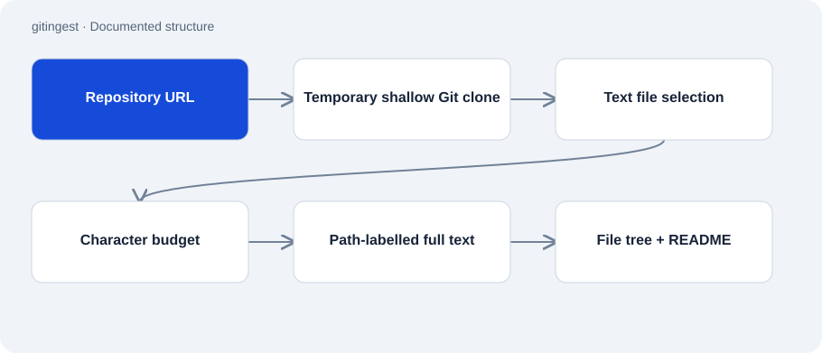

# gitingest

Public · Tool · 2026-11-02

Small Python script that combines selected text files from a Git repository into searchable output. It labels content with relative paths and switches to an explicit structure overview when the character budget is exceeded.

## Purpose

A single text output makes a codebase easier to read or supply as context for architecture questions. The script selects files but does not summarize or evaluate the project.



## Features

- Accepts a repository shorthand or URL and clones with --depth 1.
- Excludes known generated directories, binary files and lockfiles from output.
- Recognizes important extensionless files such as README and Makefile.
- Writes to stdout or a specified file.

## Structure

- gitingest.py uses only the standard library and an installed Git executable. A temporary directory holds the shallow checkout.
- File selection and text assembly are separate functions. If a block exceeds the budget, _fallback returns the tree and README instead of a silently truncated dump.

## Status and limits

- There is no content evaluation, secret redaction or complete analysis of every file.
- The README fallback does not strictly guarantee that the entire output stays within the character budget.
- Private access depends on existing Git authentication. There is no cache or incremental-update layer.
- File filters exclude content from the output; they do not replace reviewing output before sharing it.

## Getting started

Observed example: reads a public repository through a temporary shallow clone. Git must be installed.

```sh
python gitingest.py octocat/Hello-World
```

## Key files

- `gitingest.py`: Clone, selection, text assembly and budget fallback.
- `tests/test_selection.py`: Selection tests present in the repository.

## Sources

Read the README and complete gitingest.py on 2 November 2026. The script was not run and no external source repository was cloned for this review.

- [README.md](https://github.com/Atakan-24/gitingest/blob/main/README.md)
- [gitingest.py](https://github.com/Atakan-24/gitingest/blob/main/gitingest.py)

## Images and demos

The structure diagram above presents the evidenced components; it does not pretend to show a running UI.
