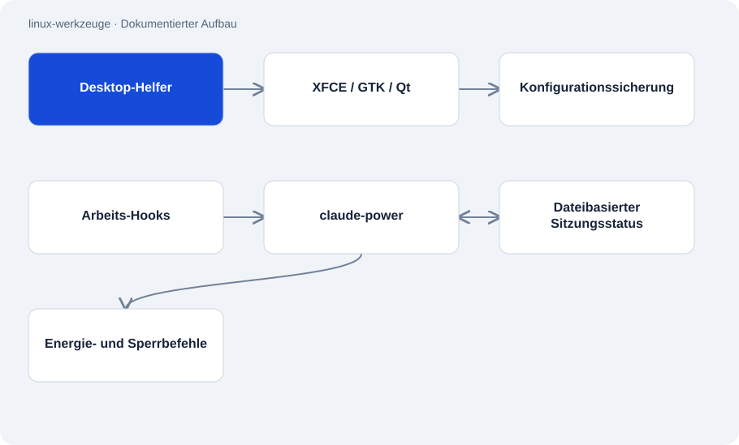

# linux-werkzeuge

Öffentlich · Werkzeug · 2026-11-02

Sammlung eigener Bash- und Python-Werkzeuge für einen Kali/XFCE-Arbeitsplatz. Enthalten sind Desktop-Anpassungen sowie Energie- und Sperrsteuerung. Weitere Ordner dokumentieren die Architektur einer lokalen Prüfoberfläche und die Absicherung eines Dienstes.

## Zweck

Die Sammlung hält nachvollziehbar fest, wie ein konkreter Linux-Arbeitsplatz angepasst wurde. Ausführbare Skripte und beschreibende Fallstudien stehen nebeneinander. Der Leser kann dadurch unterscheiden, welche Komponenten er im Repository untersuchen kann und welche nur dokumentiert sind.



## Funktionen

- GTK-/Qt-Farben, XFCE-Einstellungen, Tastenkürzel und Screenshot-Helfer.
- Hook-gesteuerte Energieverwaltung mit Status, Countdown und Deckel-/Leerlaufregeln.
- Dokumentierte Prüfoberfläche mit Freigabe, Scope-Prüfung, Hintergrundausführung und Berichten.
- Fallstudie zu Token-Anmeldung und blockierten Shell-Eingaben eines lokalen HTTP-Dienstes.

## Aufbau

- design-apply ruft xfconf-query auf und sichert Konfigurationswerte vor Änderungen. Die Skripte erwarten eine konkrete Desktop-Sitzung und zusätzliche lokale Helfer.
- claude-power verwaltet Konfiguration und Sitzungsstatus als Dateien. Hooks melden Arbeitszustände; Systemwerkzeuge setzen Energieaktionen um.
- Die separat beschriebene Tkinter-Anwendung trennt Ansichten, Hintergrundthreads und eine Queue. Ihre Ausführungslogik ist nicht veröffentlicht.

## Stand und Grenzen

- Die Skripte sind Vorlagen für einen bestimmten Rechner. Benutzerplatzhalter, Pfade und nicht enthaltene Helfer müssen angepasst werden.
- Die Sicherheits-Prüfwerkzeuge und der fremde HTTP-Server sind nicht enthalten. Deren Testresultate sind Dokumentationsaussagen.
- Die Dienstabsicherung nutzt laut Bericht noch eine Zeichensperrliste. Sie ersetzt keine saubere Übergabe von Argumentlisten.
- Dieses Audit prüft keine universelle Linux-Kompatibilität oder gegenwärtige Dienstkonfiguration.

## Einstieg

Beobachteter Statusaufruf für einen bereits eingerichteten Arbeitsplatz; installiert keine Komponenten.

```sh
claude-power status
```

Liest den Desktop-Stand. Zuvor müssen die im Skript angegebenen Benutzer- und Hilfsprogrammannahmen passen.

```sh
design-apply status
```

## Wichtige Dateien

- `desktop-setup/bin/design-apply`: Farben und gesicherte XFCE-/Qt-Einstellungen.
- `energie-sperre/claude-power`: Sitzungsstatus, Countdown und Energieaktionen.
- `kontrollzentrum-architektur/README.en.md`: Beschreibt die nicht veröffentlichte Prüfoberfläche.
- `dienst-absicherung/README.md`: Dokumentiert die Absicherung eines lokalen Dienstes.

## Belege

Root-README, vier Teilbeschreibungen sowie design-apply und claude-power am 02.11.2026 gelesen. Aussagen über die nicht veröffentlichten Komponenten bleiben als solche gekennzeichnet. Keine Desktop- oder Energieaktion ausgeführt.

- [README.md](https://github.com/Atakan-24/linux-werkzeuge/blob/main/README.md)
- [desktop-setup/README.md](https://github.com/Atakan-24/linux-werkzeuge/blob/main/desktop-setup/README.md)
- [desktop-setup/bin/design-apply](https://github.com/Atakan-24/linux-werkzeuge/blob/main/desktop-setup/bin/design-apply)
- [energie-sperre/README.md](https://github.com/Atakan-24/linux-werkzeuge/blob/main/energie-sperre/README.md)
- [energie-sperre/claude-power](https://github.com/Atakan-24/linux-werkzeuge/blob/main/energie-sperre/claude-power)
- [kontrollzentrum-architektur/README.en.md](https://github.com/Atakan-24/linux-werkzeuge/blob/main/kontrollzentrum-architektur/README.en.md)
- [dienst-absicherung/README.md](https://github.com/Atakan-24/linux-werkzeuge/blob/main/dienst-absicherung/README.md)

## Bilder und Demos

- [Dokumentierte Prüfoberfläche; Beispielablauf mit Musterdaten.](https://raw.githubusercontent.com/Atakan-24/linux-werkzeuge/main/bilder/demo/1-startseite.png)
- [Erklärung eines Beispielergebnisses in Alltagssprache.](https://raw.githubusercontent.com/Atakan-24/linux-werkzeuge/main/bilder/demo/4-was-heisst-das.png)
