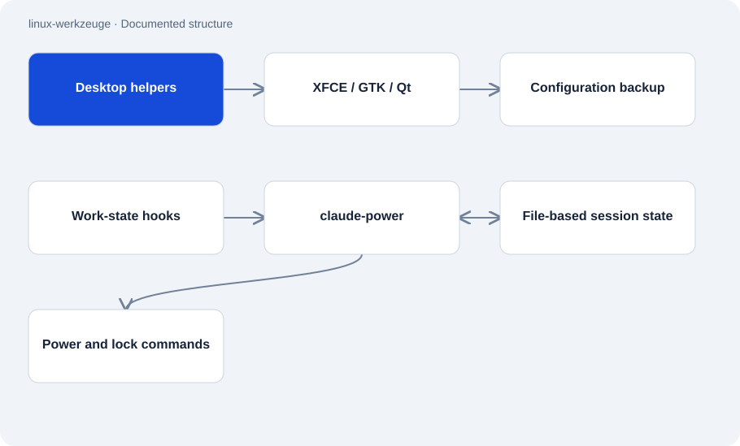

# linux-werkzeuge

Public · Tool · 2026-11-02

Collection of custom Bash and Python tools for a Kali/XFCE workstation. It includes desktop customization plus power and lock management. Other folders document a local assessment interface and the hardening of a service.

## Purpose

The collection records how a particular Linux workstation was customized. Executable scripts sit alongside descriptive case studies. Readers can distinguish components available for inspection in the repository from those described only in documentation.



## Features

- GTK/Qt colors, XFCE settings, keyboard shortcuts and screenshot helpers.
- Hook-driven power management with status, countdown and lid/idle rules.
- Documented assessment interface with authorization, scope checks, background execution and reports.
- Case study of token authentication and blocked shell input for a local HTTP service.

## Structure

- design-apply calls xfconf-query and backs up configuration values before changes. The scripts expect a particular desktop session and additional local helpers.
- claude-power keeps configuration and session state in files. Hooks report work states, while system tools carry out power actions.
- The separately documented Tkinter application separates views, worker threads and a queue. Its execution code is not published.

## Status and limits

- The scripts are templates for a particular machine. User placeholders, paths and missing helpers require adaptation.
- Assessment-tool execution code and the external HTTP server are excluded. Their reported test results are documentary claims.
- The service-hardening report still describes a character blocklist. It does not replace proper argument-list handling.
- This audit establishes neither universal Linux compatibility nor the current service configuration.

## Getting started

Observed status command for an already configured workstation; it installs no components.

```sh
claude-power status
```

Reads desktop settings. User and helper assumptions in the script must match the workstation first.

```sh
design-apply status
```

## Key files

- `desktop-setup/bin/design-apply`: Colors and backed-up XFCE/Qt settings.
- `energie-sperre/claude-power`: Session state, countdown and power actions.
- `kontrollzentrum-architektur/README.en.md`: Describes the unpublished assessment interface.
- `dienst-absicherung/README.md`: Documents hardening of a local service.

## Sources

Read the root README, four component descriptions, design-apply and claude-power on 2 November 2026. Claims about unpublished components remain identified as documentary. No desktop or power action was performed.

- [README.md](https://github.com/Atakan-24/linux-werkzeuge/blob/main/README.md)
- [desktop-setup/README.md](https://github.com/Atakan-24/linux-werkzeuge/blob/main/desktop-setup/README.md)
- [desktop-setup/bin/design-apply](https://github.com/Atakan-24/linux-werkzeuge/blob/main/desktop-setup/bin/design-apply)
- [energie-sperre/README.md](https://github.com/Atakan-24/linux-werkzeuge/blob/main/energie-sperre/README.md)
- [energie-sperre/claude-power](https://github.com/Atakan-24/linux-werkzeuge/blob/main/energie-sperre/claude-power)
- [kontrollzentrum-architektur/README.en.md](https://github.com/Atakan-24/linux-werkzeuge/blob/main/kontrollzentrum-architektur/README.en.md)
- [dienst-absicherung/README.md](https://github.com/Atakan-24/linux-werkzeuge/blob/main/dienst-absicherung/README.md)

## Images and demos

- [Documented assessment interface; example flow using sample data.](https://raw.githubusercontent.com/Atakan-24/linux-werkzeuge/main/bilder/demo/1-startseite.png)
- [Plain-language explanation of an example result.](https://raw.githubusercontent.com/Atakan-24/linux-werkzeuge/main/bilder/demo/4-was-heisst-das.png)
