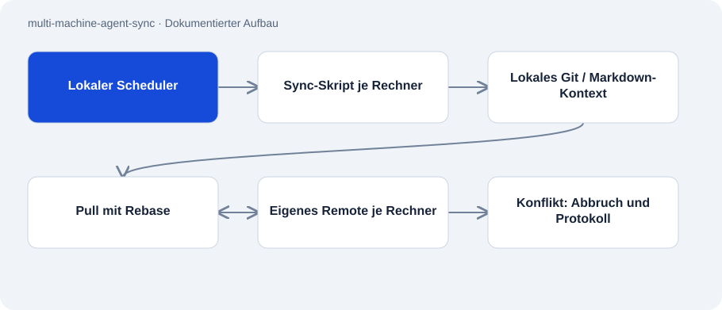

# multi-machine-agent-sync

Öffentlich · Werkzeug · 2026-11-02

Skripte und Vorlagen für Git-Backups und gemeinsamen Markdown-Kontext von Coding-Agenten. Die dokumentierte Installation verteilt sich über vier Rechner. Jeder Rechner schreibt in ein eigenes Repository und kann den Stand der anderen bei Bedarf lesen.

## Zweck

Agentensitzungen beginnen mit begrenztem Wissen über vorherige Arbeit auf anderen Rechnern. CLAUDE.md und AGENTS.md halten Projektstand und Arbeitsregeln fest. Regelmäßige Git-Synchronisation transportiert diese Dateien und andere eingeschlossene Projekte zu einem Remote.

## Funktionen

- Bash-Synchronisation für macOS/Linux sowie PowerShell-Fassung für Windows.
- Commit, Rebase und bedingter Push mit Abbruch bei Rebase-Konflikten.
- launchd-, systemd- und Task-Scheduler-Vorlagen für regelmäßige Ausführung.
- Windows gleicht die beiden Agentendateien nach Änderungszeit ab; andere Systeme verwenden laut Beschreibung einen Symlink.

## Aufbau

- Ein Scheduler startet das lokale Sync-Skript. Es arbeitet in ~/projects, erfasst Änderungen, holt den Remote-Stand mit Rebase und pusht nur vorliegende neue Commits.
- Die Linux-Einrichtung erstellt einen systemd-Benutzerdienst und einen persistenten 15-Minuten-Timer. Windows erwartet den Branch main; Bash erkennt den aktuellen Branch.
- Markdown liefert den gemeinsamen Kontext. Ein Manifest kann Verweise auf separat versionierte Projekte festhalten, ersetzt aber deren eigene Sicherung nicht.

## Stand und Grenzen

- Das dokumentierte 15-Minuten-Intervall belegt keine aktuelle Ausführung auf allen Rechnern.
- Die Skripte erzeugen Commits und Pushes; Einrichtung setzt geeignete Remotes, Git-Anmeldung und geprüfte Dateiausschlüsse voraus.
- gitignore schützt keine bereits verfolgten Geheimnisse. Der Ansatz enthält keinen vollständigen Geheimnisscanner.
- Agenten müssen Kontextänderungen selbst notieren. Die Synchronisation erzwingt das nicht und löst Konflikte nicht automatisch.

## Einstieg

Kein belastbar belegter Startbefehl für diese Repo-Rolle.

## Wichtige Dateien

- `git_auto.sh`: Bash-Ablauf mit Rebase-Abbruch.
- `windows/git_auto.ps1`: Windows-Sync und Abgleich der Agentendateien.
- `linux/setup.sh`: Legt Dienst und Timer im Benutzerkontext an.
- `templates/CLAUDE.md`: Vorlage für den gemeinsamen Kontext.

## Belege

README, beide Sync-Skripte und Linux-Einrichtung am 02.11.2026 gelesen. Der Ablauf wurde statisch geprüft. Kein Scheduler wurde eingerichtet, kein Git-Push ausgeführt und kein privater Rechnerbestand übernommen.

- [README.md](https://github.com/Atakan-24/multi-machine-agent-sync/blob/main/README.md)
- [git_auto.sh](https://github.com/Atakan-24/multi-machine-agent-sync/blob/main/git_auto.sh)
- [windows/git_auto.ps1](https://github.com/Atakan-24/multi-machine-agent-sync/blob/main/windows/git_auto.ps1)
- [linux/setup.sh](https://github.com/Atakan-24/multi-machine-agent-sync/blob/main/linux/setup.sh)

## Bilder und Demos

- [Veröffentlichtes Diagramm des Commit-/Rebase-/Push-Ablaufs.](https://raw.githubusercontent.com/Atakan-24/multi-machine-agent-sync/main/docs/sync-cycle.svg)
