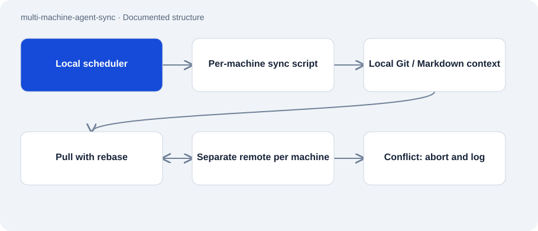

# multi-machine-agent-sync

Public · Tool · 2026-11-02

Scripts and templates for Git backups and shared Markdown context for coding agents. The documented setup spans four machines. Each machine writes to its own repository and can read another machine’s state when needed.

## Purpose

Agent sessions start with limited knowledge of earlier work on other machines. CLAUDE.md and AGENTS.md record project state and working rules. Scheduled Git synchronization sends those files and other included projects to a remote.

## Features

- Bash synchronization for macOS/Linux and a PowerShell version for Windows.
- Commit, rebase and conditional push, stopping on rebase conflicts.
- launchd, systemd and Task Scheduler templates for scheduled runs.
- Windows synchronizes the two agent files by modification time; other systems use a symlink according to the description.

## Structure

- A scheduler starts the local sync script. It works in ~/projects, commits changes, fetches remote state through rebase and pushes only when local commits remain.
- Linux setup creates a systemd user service and persistent 15-minute timer. Windows expects the main branch; Bash detects the current branch.
- Markdown supplies shared context. A manifest can record separately versioned projects but does not replace their own backups.

## Status and limits

- The documented 15-minute interval does not establish current execution on every machine.
- The scripts create commits and pushes; setup requires suitable remotes, Git authentication and reviewed file exclusions.
- gitignore does not protect secrets already tracked. This approach contains no complete credential scanner.
- Agents must record context changes themselves. Synchronization does not enforce that behavior or resolve conflicts automatically.

## Getting started

No substantiated startup command for this repository role.

## Key files

- `git_auto.sh`: Bash sequence with rebase abort.
- `windows/git_auto.ps1`: Windows sync and agent-file alignment.
- `linux/setup.sh`: Creates user-level service and timer.
- `templates/CLAUDE.md`: Template for shared context.

## Sources

Read the README, both sync scripts and Linux setup on 2 November 2026. The sequence was reviewed statically. No scheduler was installed, Git push performed or private machine inventory copied.

- [README.md](https://github.com/Atakan-24/multi-machine-agent-sync/blob/main/README.md)
- [git_auto.sh](https://github.com/Atakan-24/multi-machine-agent-sync/blob/main/git_auto.sh)
- [windows/git_auto.ps1](https://github.com/Atakan-24/multi-machine-agent-sync/blob/main/windows/git_auto.ps1)
- [linux/setup.sh](https://github.com/Atakan-24/multi-machine-agent-sync/blob/main/linux/setup.sh)

## Images and demos

- [Published diagram of the commit/rebase/push sequence.](https://raw.githubusercontent.com/Atakan-24/multi-machine-agent-sync/main/docs/sync-cycle.svg)
