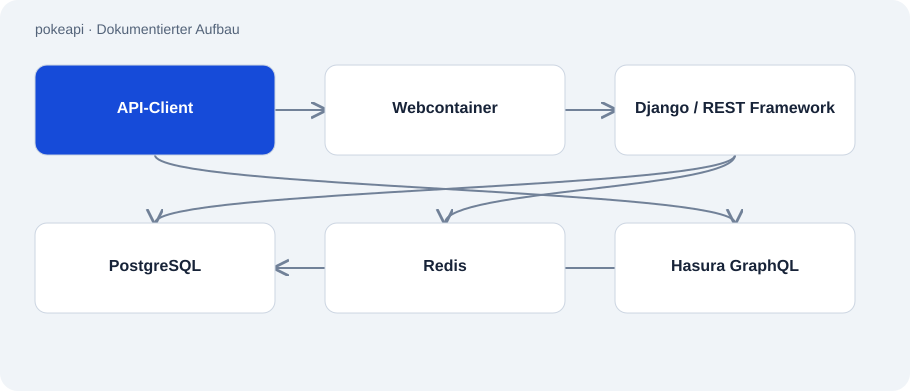

# pokeapi

Öffentlich · Fremdprojekt / Fork · 2026-11-02

Fork des Projekts PokeAPI/pokeapi, einer REST- und GraphQL-Schnittstelle für Pokémon-Daten. Das Repository gehört zur öffentlichen Lern- und Arbeitsumgebung. Es wird nicht als von Atakan entwickelte API oder als Nachweis eigener Beiträge dargestellt.

## Zweck

Der Quellbestand erlaubt das Studium einer größeren datengetriebenen Django-Anwendung. Die dokumentierte lokale Einrichtung lädt Abhängigkeiten, legt die Datenbank an und startet einen Entwicklungsserver. Der Code stammt aus dem upstream Projekt; eigene Änderungen wurden in diesem Audit nicht ermittelt.



## Funktionen

- Django und Django REST Framework für die API.
- CSV-basierte Datenaufbereitung und versionierte Datenmodelle.
- Docker-Compose-Dienste für PostgreSQL, Redis, Webserver und Hasura.
- Makefile-Aufgaben für Installation, Entwicklung und Qualitätsprüfungen.

## Aufbau

- Django bindet pokemon_v2-Routen ein. Die Paketdatei beschreibt API-, Caching- und Datenbankbibliotheken.
- Compose trennt Anwendung, PostgreSQL und Redis. Ein Webcontainer übernimmt externe HTTP-Zugriffe; Hasura nutzt dieselbe Datenbank für GraphQL.
- CSV-Import und Migrationen sind getrennte Schritte. Das Neuaufbauen der Daten kann vorhandene Tabelleninhalte ersetzen.

## Stand und Grenzen

- GitHub kennzeichnet diesen Bestand als Fork von PokeAPI/pokeapi. Eigene Autorenschaft oder gemergte Beiträge wurden nicht nachgewiesen.
- README-Badges und öffentlicher API-Betrieb beziehen sich auf upstream, nicht auf diesen Fork.
- Keine Installation, Datenladung oder Containerprüfung ausgeführt. Beispielkonfiguration ist keine Sicherheitsfreigabe für einen öffentlichen Server.

## Einstieg

Zeigt die beobachteten Aufgaben ohne Datenbankaufbau. Weitere Einrichtung nur in einer frischen lokalen Testumgebung nach upstream Anleitung.

```sh
make help
```

Dokumentierte lokale Installation über vorhandenes uv; lädt Projektabhängigkeiten.

```sh
make install
```

Startet nach abgeschlossener lokaler Datenbankeinrichtung den Entwicklungsserver.

```sh
make serve
```

## Wichtige Dateien

- `pyproject.toml`: Django- und Datenbankabhängigkeiten.
- `Makefile`: Beobachtete Entwicklungsaufgaben.
- `config/urls.py`: Bindet die API-Routen ein.
- `docker-compose.yml`: Container und Datenvolumes.

## Belege

Fork-Metadaten, README, Paketdatei, Makefile, URL-Konfiguration und Compose-Datei am 02.11.2026 gelesen. Die Darstellung beschreibt upstream Architektur; ein Vergleich eigener Commits mit upstream war nicht Teil dieses Audits.

- [Fork metadata](https://api.github.com/repos/Atakan-24/pokeapi)
- [README.md](https://github.com/Atakan-24/pokeapi/blob/master/README.md)
- [pyproject.toml](https://github.com/Atakan-24/pokeapi/blob/master/pyproject.toml)
- [Makefile](https://github.com/Atakan-24/pokeapi/blob/master/Makefile)
- [config/urls.py](https://github.com/Atakan-24/pokeapi/blob/master/config/urls.py)
- [docker-compose.yml](https://github.com/Atakan-24/pokeapi/blob/master/docker-compose.yml)

## Bilder und Demos

Die Struktur-Grafik oben stellt den belegten Aufbau dar; es wird kein laufendes UI vorgetäuscht.
