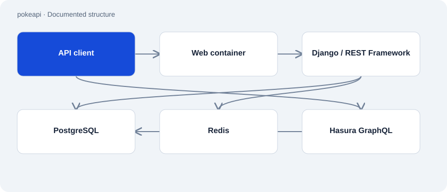

# pokeapi

Public · Upstream / fork · 2026-11-02

Fork of PokeAPI/pokeapi, a REST and GraphQL interface for Pokémon data. The repository belongs to the public learning and working environment. It is not presented as an API authored by Atakan or as evidence of personal contributions.

## Purpose

The source supports studying a larger data-driven Django application. Its documented local setup installs dependencies, initializes a database and starts a development server. The code comes from the upstream project; this audit did not establish personal modifications.



## Features

- Django and Django REST Framework API.
- CSV-based data preparation and versioned data models.
- Docker Compose services for PostgreSQL, Redis, web serving and Hasura.
- Makefile tasks for installation, development and quality checks.

## Structure

- Django includes pokemon_v2 routes. The package manifest declares API, caching and database libraries.
- Compose separates the application, PostgreSQL and Redis. A web container handles external HTTP access, while Hasura uses the database for GraphQL.
- CSV loading and migrations are separate steps. Rebuilding data can replace existing table contents.

## Status and limits

- GitHub identifies this repository as a fork of PokeAPI/pokeapi. Personal authorship or merged contributions were not established.
- README badges and the public API service refer to upstream, not to this fork.
- No installation, data load or container test was performed. Sample configuration is not approval for a public server deployment.

## Getting started

Lists the observed tasks without building a database. Follow upstream instructions for further setup in a fresh local test environment.

```sh
make help
```

Documented local installation using an existing uv installation; downloads project dependencies.

```sh
make install
```

Starts the development server after local database setup is complete.

```sh
make serve
```

## Key files

- `pyproject.toml`: Django and database dependencies.
- `Makefile`: Observed development tasks.
- `config/urls.py`: Includes API routes.
- `docker-compose.yml`: Containers and data volumes.

## Sources

Read fork metadata, README, package manifest, Makefile, URL configuration and Compose file on 2 November 2026. This describes upstream architecture; comparing personal commits against upstream was outside this audit.

- [Fork metadata](https://api.github.com/repos/Atakan-24/pokeapi)
- [README.md](https://github.com/Atakan-24/pokeapi/blob/master/README.md)
- [pyproject.toml](https://github.com/Atakan-24/pokeapi/blob/master/pyproject.toml)
- [Makefile](https://github.com/Atakan-24/pokeapi/blob/master/Makefile)
- [config/urls.py](https://github.com/Atakan-24/pokeapi/blob/master/config/urls.py)
- [docker-compose.yml](https://github.com/Atakan-24/pokeapi/blob/master/docker-compose.yml)

## Images and demos

The structure diagram above presents the evidenced components; it does not pretend to show a running UI.
