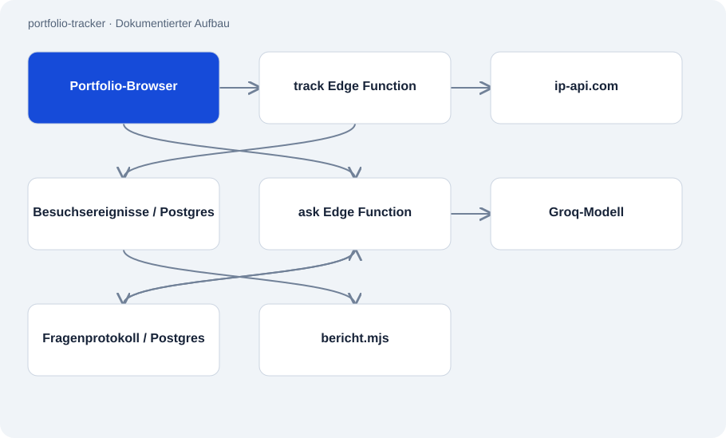

# portfolio-tracker

Öffentlich · Anwendung · 2026-11-02

Kleines Backend für Besuchsereignisse und den Fragebereich einer Portfolio-Seite. Zwei Supabase Edge Functions übernehmen die HTTP-Anfragen; ein Node-Skript liest einen Kurzbericht aus gespeicherten Besuchsdaten.

## Zweck

Der Betreiber kann sehen, welche Seiten und ausgehenden Links besucht wurden. Besucher können Fragen an ein Modell stellen, dessen Systemprompt einen festen Wissensblock zum Portfolio enthält. Die Implementierung trennt Ereigniserfassung, Modellaufruf und Berichtsausgabe.



## Funktionen

- Ereignistypen pageview und click mit begrenzten Textfeldern.
- Länder-/Regionsabfrage und Speicherung von Seiten- und Referrer-Metadaten.
- Fragebereich mit SHA-256-IP-Hash sowie Besucher- und Tagesquoten.
- CLI-Bericht über Länder, Verweisquellen und häufig geklickte Ziele.

## Aufbau

- track nimmt POST-JSON entgegen, fragt ip-api.com mit der übermittelten IP ab und schreibt Ereignisse in portfolio_visits. Die rohe IP wird in diesem Datensatz nicht gespeichert.
- ask zählt heutige Logeinträge, ruft bei verfügbarer Quote Groq mit einem festen Systemprompt auf und protokolliert Frage und Antwort.
- bericht.mjs liest lokale Umgebungswerte und fragt die Supabase-REST-Schnittstelle ab. Die Edge Functions benötigen Deno/Supabase und laufen nicht als Node-Skripte.

## Stand und Grenzen

- Der Geo-Anbieter erhält die rohe IP; der aktuelle Aufruf nutzt HTTP. Ein IP-Hash ist ein pseudonymes Merkmal, keine Anonymitätsgarantie.
- Nur ask zeigt im geprüften Code Quotenprüfungen. track enthält keine sichtbare Ratenbegrenzung, obwohl die README dies breit formuliert.
- Zählen und Schreiben der Fragequote sind getrennte Schritte. Das Audit bestätigt keine atomare Durchsetzung oder Produktions-RLS.
- Freitext und Referrer können persönliche Angaben enthalten. Der feste Prompt verhindert keine falschen Antworten und kann veralten.
- Release-Prüfung 02.11.2026: Öffentliche Leserechte auf Besucher-/Chatprotokolle wurden entfernt. Der alte Bericht per anonymem Schlüssel benötigt einen administrativen Zugriffsweg und ist so nicht mehr nutzbar.

## Einstieg

Im Checkout eine lokale Konfigurationsdatei anlegen und mit eigenen Projektwerten ausfüllen.

```sh
cp .env.example .env.local
```

Liest bei vorhandener Konfiguration den Bericht der letzten sieben Tage.

```sh
node bericht.mjs
```

Dokumentierter Leseaufruf für dreißig Tage.

```sh
node bericht.mjs --tage=30
```

## Wichtige Dateien

- `functions/track/index.ts`: Ereignisannahme, Geo-Abfrage und Datenbankeintrag.
- `functions/ask/index.ts`: Fester Wissensprompt, Quotenprüfung und Modellaufruf.
- `bericht.mjs`: Lokaler Bericht über gespeicherte Ereignisse.

## Belege

README und alle drei Implementierungsdateien am 02.11.2026 gelesen. Datenbankschema, Deployment und externe Dienste wurden nicht geprüft. Quellcodeabweichungen von der README sind ausdrücklich festgehalten. Zusätzlich wurden die produktiven RLS-Rechte sowie die bereitgestellten Funktionen ask v11 und track v4 geprüft. Keine Besucher- oder Chatdaten gelesen.

- [README.md](https://github.com/Atakan-24/portfolio-tracker/blob/main/README.md)
- [functions/track/index.ts](https://github.com/Atakan-24/portfolio-tracker/blob/main/functions/track/index.ts)
- [functions/ask/index.ts](https://github.com/Atakan-24/portfolio-tracker/blob/main/functions/ask/index.ts)
- [bericht.mjs](https://github.com/Atakan-24/portfolio-tracker/blob/main/bericht.mjs)

## Bilder und Demos

Die Struktur-Grafik oben stellt den belegten Aufbau dar; es wird kein laufendes UI vorgetäuscht.
