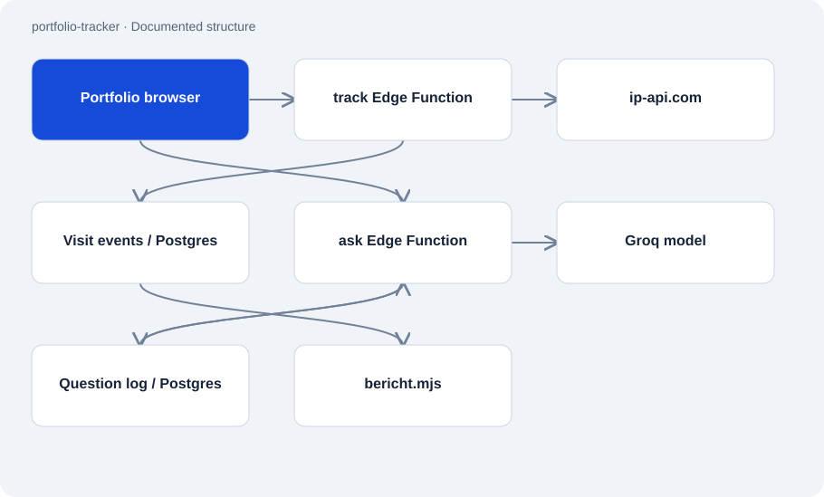

# portfolio-tracker

Public · Application · 2026-11-02

Small backend for portfolio visit events and a question box. Two Supabase Edge Functions receive HTTP requests, while a Node script reads a brief report from stored visit data.

## Purpose

The owner can inspect page views and outbound link clicks. Visitors can ask a model questions using a system prompt containing a fixed portfolio knowledge block. The implementation separates event collection, model calls and report output.



## Features

- Pageview and click event types with clipped text fields.
- Country/region lookup and storage of page and referrer metadata.
- Question endpoint with SHA-256 IP hashes and visitor/daily quotas.
- CLI report showing countries, referrers and frequently clicked destinations.

## Structure

- track accepts POST JSON, queries ip-api.com using the forwarded IP and writes events to portfolio_visits. The raw IP is not stored in that event record.
- ask counts today’s log entries, calls Groq with a fixed system prompt when quota remains, and records the question and answer.
- bericht.mjs reads local environment values and queries Supabase REST. The Edge Functions need Deno/Supabase and do not run as Node scripts.

## Status and limits

- The geo provider receives the raw IP; the current request uses HTTP. An IP hash is a pseudonymous identifier, not an anonymity guarantee.
- Only ask contains visible quota checks in the reviewed code. track has no visible rate limit despite broad README wording.
- Question-quota counting and insertion are separate steps. This audit does not establish atomic enforcement or production RLS.
- Free text and referrers can contain personal information. The fixed prompt cannot prevent inaccurate answers and can become outdated.

## Getting started

Create a local configuration file in the checkout and fill it with your own project values.

```sh
cp .env.example .env.local
```

Reads the last seven days of reporting data when configuration is available.

```sh
node bericht.mjs
```

Documented read command for thirty days.

```sh
node bericht.mjs --tage=30
```

## Key files

- `functions/track/index.ts`: Event input, geo lookup and database insert.
- `functions/ask/index.ts`: Fixed knowledge prompt, quota check and model call.
- `bericht.mjs`: Local report over stored events.

## Sources

Read the README and all three implementation files on 2 November 2026. Database schema, deployment and external services were not tested. Source differences from the README are explicitly recorded.

- [README.md](https://github.com/Atakan-24/portfolio-tracker/blob/main/README.md)
- [functions/track/index.ts](https://github.com/Atakan-24/portfolio-tracker/blob/main/functions/track/index.ts)
- [functions/ask/index.ts](https://github.com/Atakan-24/portfolio-tracker/blob/main/functions/ask/index.ts)
- [bericht.mjs](https://github.com/Atakan-24/portfolio-tracker/blob/main/bericht.mjs)

## Images and demos

The structure diagram above presents the evidenced components; it does not pretend to show a running UI.
