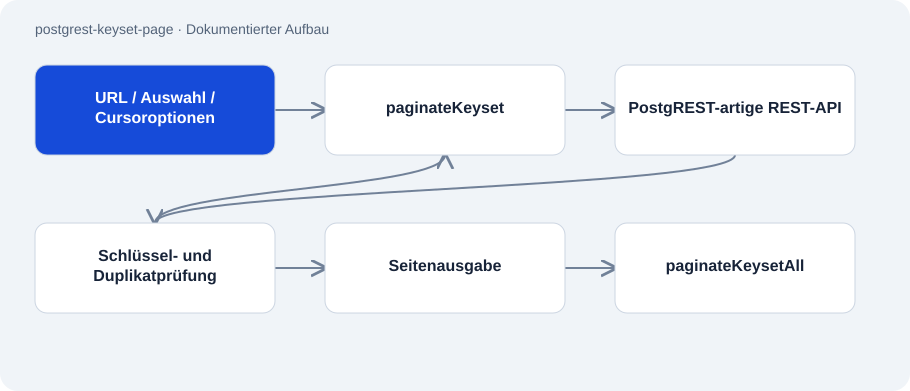

# postgrest-keyset-page

Öffentlich · Werkzeug · 2026-11-02

Abhängigkeitsfreie JavaScript-Hilfe für Cursor-Paginierung über PostgREST-artige REST-Schnittstellen. Sie liest Seiten nach einem stabilen Schlüssel statt nach verschiebbaren Zeilenpositionen und bricht bei erkannten Vertragsverletzungen ab.

## Zweck

Offset-Paginierung kann bei gleichzeitigen Änderungen doppelte oder fehlende Datensätze produzieren. Die Hilfe adressiert diese Fehlerklasse mit aufsteigender Schlüsselreihenfolge und einer bewegten Untergrenze. Ein mitgelieferter Test stellt die Verschiebung eines Offset-Fensters nach.



## Funktionen

- Asynchroner Seitengenerator sowie Wrapper zum Sammeln aller Seiten.
- Fügt den Schlüssel bei Bedarf zur Auswahl hinzu.
- Prüft HTTP-Fehler, fehlenden Schlüssel, doppelte Werte und maximale Seitenzahl.
- Austauschbare fetch-Funktion für lokale Tests.

## Aufbau

- paginateKeyset baut select-, order-, limit- und gt-Parameter pro Anfrage. Ein Set merkt bereits gelesene Schlüssel.
- paginateKeysetAll sammelt die vom Generator gelieferten Seiten. Paketdatei und Implementierung verwenden ES-Module und Node.js ab Version 18.
- Das README dokumentiert neun Tests, einschließlich eines veränderlichen Fake-Backends.

## Stand und Grenzen

- Der Cursor benötigt einen eindeutigen, stabilen und sortierbaren Schlüssel. Zusammengesetzte Cursor werden nicht unterstützt.
- Cursor-Paginierung erzeugt keinen Datenbanksnapshot und garantiert nicht die Vollständigkeit gegenüber beliebigen gleichzeitigen Updates oder Löschungen.
- Auch der Generator speichert alle gesehenen Schlüssel. Der Sammel-Wrapper hält zusätzlich sämtliche Ergebniszeilen im Speicher.
- Die Lizenz erklärt alle Rechte vorbehalten; öffentlicher Quellcode bedeutet hier keine allgemeine Wiederverwendungslizenz.

## Einstieg

Führt im Checkout die mitgelieferten lokalen Tests aus; keine Installation von Laufzeitabhängigkeiten nötig.

```sh
node --test
```

## Wichtige Dateien

- `paginate.mjs`: Generator und Sammel-Wrapper.
- `paginate.test.mjs`: Vertrags- und Paginierungsregressionstests.
- `package.json`: ES-Module, Testaufruf und Node-Anforderung.

## Belege

README, komplette Implementierung und Paketdatei am 02.11.2026 gelesen. Testzahlen sind dokumentarisch übernommen; weder Tests noch Datenbankanfragen wurden ausgeführt.

- [README.md](https://github.com/Atakan-24/postgrest-keyset-page/blob/main/README.md)
- [paginate.mjs](https://github.com/Atakan-24/postgrest-keyset-page/blob/main/paginate.mjs)
- [package.json](https://github.com/Atakan-24/postgrest-keyset-page/blob/main/package.json)

## Bilder und Demos

Die Struktur-Grafik oben stellt den belegten Aufbau dar; es wird kein laufendes UI vorgetäuscht.
