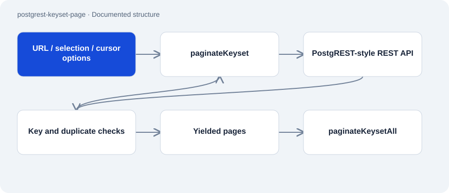

# postgrest-keyset-page

Public · Tool · 2026-11-02

Dependency-free JavaScript helper for cursor pagination over PostgREST-style REST APIs. It reads pages using a stable key instead of shifting row positions and stops on detected contract violations.

## Purpose

Offset pagination can yield duplicate or missing records during concurrent changes. This helper addresses that failure class with ascending key order and a moving lower bound. An included test reproduces a shifting offset window.



## Features

- Asynchronous page generator and a wrapper that collects all pages.
- Adds the key to the selection when needed.
- Checks HTTP errors, missing keys, duplicate values and a page-count limit.
- Injectable fetch function for local tests.

## Structure

- paginateKeyset builds select, order, limit and gt parameters for each request. A Set remembers keys already read.
- paginateKeysetAll collects pages yielded by the generator. The manifest and implementation use ES modules and Node.js 18 or newer.
- The README documents nine tests, including a mutating fake backend.

## Status and limits

- The cursor requires a unique, stable and sortable key. Composite cursors are not supported.
- Cursor pagination does not create a database snapshot or guarantee completeness under arbitrary concurrent updates or deletions.
- Even the generator retains all seen keys. The collection wrapper additionally holds every result row in memory.
- The license reserves all rights; public source does not provide a general reuse license here.

## Getting started

Runs the included local tests in the checkout; no runtime dependency installation is required.

```sh
node --test
```

## Key files

- `paginate.mjs`: Generator and collection wrapper.
- `paginate.test.mjs`: Contract and pagination regression tests.
- `package.json`: ES modules, test command and Node requirement.

## Sources

Read the README, complete implementation and package manifest on 2 November 2026. Test counts are documentary; no tests or database requests were run.

- [README.md](https://github.com/Atakan-24/postgrest-keyset-page/blob/main/README.md)
- [paginate.mjs](https://github.com/Atakan-24/postgrest-keyset-page/blob/main/paginate.mjs)
- [package.json](https://github.com/Atakan-24/postgrest-keyset-page/blob/main/package.json)

## Images and demos

The structure diagram above presents the evidenced components; it does not pretend to show a running UI.
