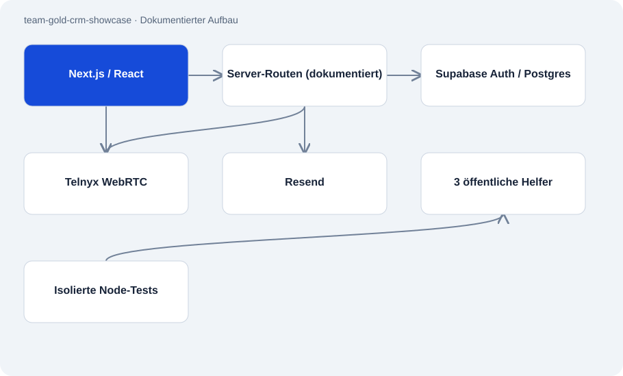

# team-gold-crm-showcase

Öffentlich · Fallstudie · 2026-11-02

Öffentliche Fallstudie eines CRM für Atakans eigenes Unternehmen Team Gold. Sie zeigt den Weg von importierten Firmenkontakten über Zuweisung und Browsertelefonie bis zur Auswertung. Die veröffentlichten Ansichten stammen aus einer lokalen Sitzung mit erfundenen Daten.

## Zweck

Vertriebsarbeit verteilt sich sonst auf Kontaktlisten, Telefonie und Nachfassaufgaben. Die dokumentierte Anwendung verbindet diese Schritte in einer Oberfläche für Admins, Manager und Mitarbeiter. Das öffentliche Repository macht Aufbau und ausgewählte Entscheidungen nachvollziehbar, ohne Zugang zum Geschäftssystem zu geben.



## Funktionen

- Feature-Tour mit Kontaktpools, Anrufen, Aufzeichnungen, Auswertungen und Teamverwaltung.
- Dokumentierte Rollenansichten sowie englische, deutsche und arabische Oberfläche.
- Drei veröffentlichte TypeScript-Helfer für Telefonnummern, E-Mail-Bereinigung und stabile Empfängerdeduplizierung.
- Rundgang-Video und Screenshots mit synthetischen Firmen, Beispieladressen und fiktiven Nummern.

## Aufbau

- Die Fallstudie beschreibt Next.js/React im Browser und serverseitige API-Routen. Supabase übernimmt Anmeldung und PostgreSQL-Datenhaltung; Telnyx und Resend stehen für Telefonie und E-Mail.
- Der öffentliche Code besteht ausschließlich aus drei reinen Helfermodulen. Die Node-Tests importieren sie direkt; sie benötigen weder Datenbank noch Providerzugang.
- Die dokumentierten 41 Dashboard-Seiten, 159 API-Routen und 104 nummerierten Migrationen beschreiben den geprüften privaten Quellstand.

## Stand und Grenzen

- Die vollständige Anwendung, Datenbankschemata und Provider-Routen sind nicht enthalten. Dieses Repository startet kein CRM.
- Quellumfang und gezeigte Funktionen belegen weder aktivierte Produktionsrouten noch ausgerollte Migrationen oder Kundenergebnisse.
- Die Helfertests prüfen weder Telefonintegration noch RLS. Telefonnummernnormalisierung bestätigt keine Erreichbarkeit; E-Mail-Bereinigung ist kein vollständiger Validator.

## Einstieg

Im öffentlichen Repository mit Node.js 24 oder neuer ausführen. Prüft nur die drei isolierten Helfer.

```sh
npm test
```

## Wichtige Dateien

- `README.md`: Systemüberblick und Veröffentlichungsgrenzen.
- `docs/SYSTEM-WALKTHROUGH.md`: Dokumentierter Ablauf und vereinfachte Verantwortlichkeiten.
- `src/lib/phone.ts`: Normalisiert Nummern mit bekanntem Länderkontext.
- `src/lib/normEmail.ts`: Entfernt Mailto- und Anzeigenamenhüllen.
- `src/lib/dedupeEmpfaenger.ts`: Behält den ersten Eintrag je normalisiertem Empfänger.

## Belege

README, Übersicht, Paketdatei und alle drei veröffentlichten Helfer am 02.11.2026 gelesen. Die Architektur der privaten Anwendung ist in dieser Prüfung dokumentarisch belegt; ihre Laufzeit wurde nicht geprüft.

- [README.md](https://github.com/Atakan-24/team-gold-crm-showcase/blob/main/README.md)
- [overview.md](https://github.com/Atakan-24/team-gold-crm-showcase/blob/main/overview.md)
- [src/lib/phone.ts](https://github.com/Atakan-24/team-gold-crm-showcase/blob/main/src/lib/phone.ts)
- [src/lib/normEmail.ts](https://github.com/Atakan-24/team-gold-crm-showcase/blob/main/src/lib/normEmail.ts)
- [src/lib/dedupeEmpfaenger.ts](https://github.com/Atakan-24/team-gold-crm-showcase/blob/main/src/lib/dedupeEmpfaenger.ts)
- [package.json](https://github.com/Atakan-24/team-gold-crm-showcase/blob/main/package.json)

## Bilder und Demos

- [Dashboard aus der lokalen Sitzung mit synthetischen Daten.](https://raw.githubusercontent.com/Atakan-24/team-gold-crm-showcase/main/docs/images/02-dashboard.png)
- [Rundgang durch denselben synthetischen Datensatz.](https://raw.githubusercontent.com/Atakan-24/team-gold-crm-showcase/main/docs/media/demo.mp4)
