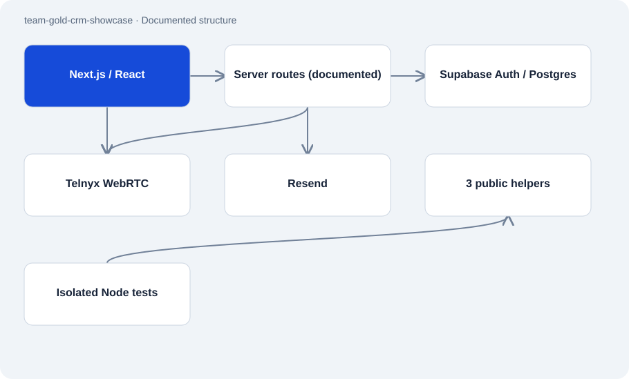

# team-gold-crm-showcase

Public · Case study · 2026-11-02

Public case study of a CRM for Atakan’s own business, Team Gold. It presents the path from imported business contacts through assignment and browser calls to outcome review. The published screens were captured locally with invented data.

## Purpose

Sales work otherwise spans contact lists, telephony and follow-up tasks. The documented application combines those steps in one interface for admins, managers and representatives. The public repository explains its structure and selected decisions without granting access to the business system.



## Features

- Feature tour covering contact pools, calls, recordings, insights and team management.
- Documented role-specific views and an English, German and Arabic interface.
- Three published TypeScript helpers for phone normalization, email cleanup and stable recipient deduplication.
- Walkthrough video and screenshots using synthetic businesses, example addresses and fictional numbers.

## Structure

- The case study describes Next.js/React in the browser and server API routes. Supabase supplies authentication and PostgreSQL storage; Telnyx and Resend handle telephony and email.
- Public executable code consists only of three pure helper modules. Node tests import them directly and need no database or provider access.
- The documented 41 dashboard pages, 159 API routes and 104 numbered migrations describe the reviewed private source snapshot.

## Status and limits

- The complete application, database schemas and provider routes are excluded. This repository cannot launch the CRM.
- Source counts and illustrated features establish neither enabled production routes nor deployed migrations or customer outcomes.
- Helper tests cover neither telephony integration nor RLS. Phone normalization does not establish reachability, and email cleanup is not a complete validator.

## Getting started

Run in the public repository with Node.js 24 or newer. Tests only the three isolated helpers.

```sh
npm test
```

## Key files

- `README.md`: System overview and publication boundaries.
- `docs/SYSTEM-WALKTHROUGH.md`: Documented workflow and simplified responsibilities.
- `src/lib/phone.ts`: Normalizes numbers with known country context.
- `src/lib/normEmail.ts`: Removes mailto and display-name wrappers.
- `src/lib/dedupeEmpfaenger.ts`: Keeps the first entry for each normalized recipient.

## Sources

Read the README, overview, package file and all three public helpers on 2 November 2026. This review relies on documentary evidence for the private application’s architecture and did not test its runtime.

- [README.md](https://github.com/Atakan-24/team-gold-crm-showcase/blob/main/README.md)
- [overview.md](https://github.com/Atakan-24/team-gold-crm-showcase/blob/main/overview.md)
- [src/lib/phone.ts](https://github.com/Atakan-24/team-gold-crm-showcase/blob/main/src/lib/phone.ts)
- [src/lib/normEmail.ts](https://github.com/Atakan-24/team-gold-crm-showcase/blob/main/src/lib/normEmail.ts)
- [src/lib/dedupeEmpfaenger.ts](https://github.com/Atakan-24/team-gold-crm-showcase/blob/main/src/lib/dedupeEmpfaenger.ts)
- [package.json](https://github.com/Atakan-24/team-gold-crm-showcase/blob/main/package.json)

## Images and demos

- [Dashboard captured locally with synthetic data.](https://raw.githubusercontent.com/Atakan-24/team-gold-crm-showcase/main/docs/images/02-dashboard.png)
- [Walkthrough using the same synthetic dataset.](https://raw.githubusercontent.com/Atakan-24/team-gold-crm-showcase/main/docs/media/demo.mp4)
