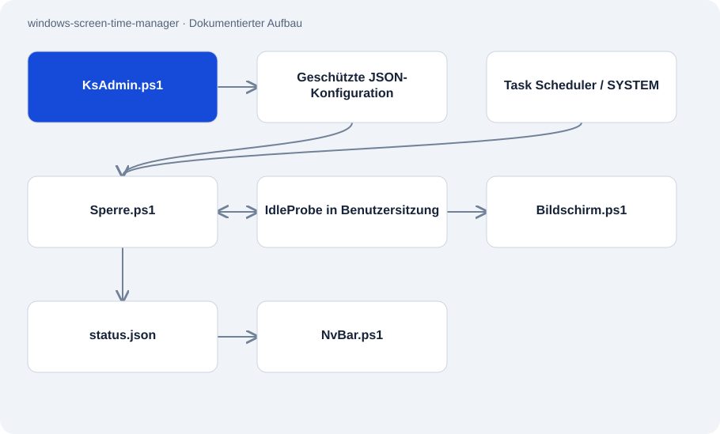

# windows-screen-time-manager

Öffentlich · Anwendung · 2026-11-02

Windows-Anwendung zur Bildschirmzeitverwaltung mit PowerShell und einem kleinen C#-Helfer. Eine privilegierte Zeiterfassung läuft getrennt von den sichtbaren Status- und Sperrfenstern. Die Dokumentation zeigt bestehende Oberflächen und benennt offene Integrationstests.

## Zweck

Das System setzt Tageslimits für die Nutzung eines Windows-Rechners um. Eine Verwaltungsoberfläche bearbeitet Regeln und Bonuszeit; Benutzer sehen Warnungen, verbleibende Zeit und die Sperranzeige. Die Trennung zwischen SYSTEM-Aufgabe und angemeldeter Sitzung ist ein zentraler Teil des Entwurfs.

## Funktionen

- Tageslimits, Nachspielzeit, Bonuszeit und ein konfigurierbarer Tageswechsel.
- Pausen können nach den eingestellten Regeln verbrauchte Zeit teilweise zurückgeben.
- JSON-Konfiguration, gesalzene PBKDF2-Prüfung für PINs und getrennte Dateirechte.
- Statusleiste und Vollbildansichten einschließlich ausdrücklich simulierter Fehlerbilder.

## Aufbau

- Task Scheduler startet Sperre.ps1 im SYSTEM-Kontext. Das Skript erfasst aktive Sitzungen und nutzt WTS/Win32 zum Start interaktiver Fenster.
- IdleProbe.cs misst GetLastInputInfo innerhalb einer Benutzersitzung und schreibt den Wert über eine temporäre Datei.
- Die Engine veröffentlicht status.json für die Benutzeranzeige. Geschützte Konfiguration und Laufzeitdaten gehören laut Entwurf in einen nur administrativ beschreibbaren Ordner.

## Stand und Grenzen

- Frische Installation und vollständige Langzeitabfolge sind nicht als geprüft dokumentiert. Der geführte Installer bleibt experimentell.
- Wirksame ACLs, Sitzungswechsel, Trigger und Deinstallation müssen auf einem Windows-Testrechner geprüft werden.
- Ein Windows-Administrator kann Dateien ändern und die Regeln umgehen. Einige Bestandsskripte enthalten feste Kontonamen.
- Fehler- und Reparaturbilder sind Simulationen. Es besteht keine Verbindung zu Microsoft oder NVIDIA.

## Einstieg

Kein belastbar belegter Startbefehl für diese Repo-Rolle.

## Wichtige Dateien

- `Sperre.ps1`: Privilegierte Zeit- und Sitzungslogik.
- `Bildschirm.ps1`: Interaktive Sperr- und Vorschauanzeigen.
- `KsAdmin.ps1`: Verwaltungsoberfläche für Regeln und Zugang.
- `IdleProbe.cs`: Win32-Helfer zur Leerlaufmessung.
- `docs/INSTALLER-SECURITY.md`: Geprüfte Installerlogik und offene Windows-Tests.

## Belege

README, Architektur, Installerprüfung, Zeitengine und C#-Helfer am 02.11.2026 gelesen. Vorhandene Testaussagen stammen aus der Dokumentation. Keine Installation oder Windows-Laufzeitprüfung ausgeführt.

- [README.md](https://github.com/Atakan-24/windows-screen-time-manager/blob/master/README.md)
- [docs/ARCHITECTURE.md](https://github.com/Atakan-24/windows-screen-time-manager/blob/master/docs/ARCHITECTURE.md)
- [docs/INSTALLER-SECURITY.md](https://github.com/Atakan-24/windows-screen-time-manager/blob/master/docs/INSTALLER-SECURITY.md)
- [Sperre.ps1](https://github.com/Atakan-24/windows-screen-time-manager/blob/master/Sperre.ps1)
- [IdleProbe.cs](https://github.com/Atakan-24/windows-screen-time-manager/blob/master/IdleProbe.cs)

## Bilder und Demos

- [Veröffentlichte Vorschau einer simulierten Fehleranzeige.](https://raw.githubusercontent.com/Atakan-24/windows-screen-time-manager/master/shot-bsod.png)
- [Veröffentlichte Terminalansicht der Sperroberfläche.](https://raw.githubusercontent.com/Atakan-24/windows-screen-time-manager/master/shot-terminal.png)
- [Im README verlinktes Video der simulierten Fehlerdiagnose.](https://youtube.com/shorts/ujELrVr45qw)
