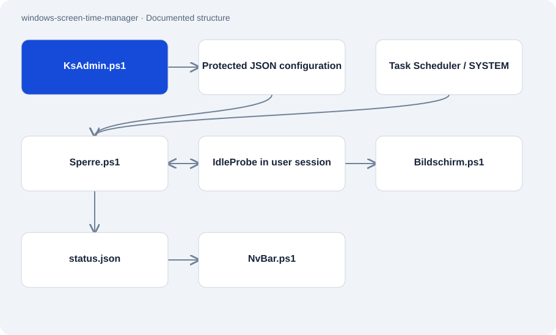

# windows-screen-time-manager

Public · Application · 2026-11-02

Windows screen-time application built with PowerShell and a small C# helper. Privileged usage tracking runs separately from visible status and lock windows. The documentation shows existing interfaces and identifies outstanding integration tests.

## Purpose

The system implements daily usage limits on a Windows computer. An administration interface edits rules and bonus time; users see warnings, remaining time and the lock display. Separating the SYSTEM task from the signed-in session is a central design concern.

## Features

- Daily limits, grace time, bonus time and a configurable daily reset.
- Breaks can restore some consumed time according to configured rules.
- JSON configuration, salted PBKDF2 verification for PINs and separate file permissions.
- Status bar and fullscreen views, including explicitly simulated error screens.

## Structure

- Task Scheduler starts Sperre.ps1 as SYSTEM. The script tracks active sessions and uses WTS/Win32 to launch interactive windows.
- IdleProbe.cs measures GetLastInputInfo inside a user session and writes its result through a temporary file.
- The engine publishes status.json for the user display. The design places protected configuration and runtime data in an administrator-writable folder.

## Status and limits

- Fresh installation and the complete long-running sequence are not documented as verified. The guided installer remains experimental.
- Effective ACLs, session switching, triggers and uninstall must be checked on a Windows test machine.
- A Windows administrator can change files and bypass the rules. Some existing scripts contain fixed account names.
- Error and repair screens are simulations. The project is not affiliated with Microsoft or NVIDIA.

## Getting started

No substantiated startup command for this repository role.

## Key files

- `Sperre.ps1`: Privileged time and session logic.
- `Bildschirm.ps1`: Interactive lock and preview displays.
- `KsAdmin.ps1`: Administration interface for rules and access.
- `IdleProbe.cs`: Win32 helper for idle measurement.
- `docs/INSTALLER-SECURITY.md`: Reviewed installer logic and outstanding Windows tests.

## Sources

Read the README, architecture, installer review, time engine and C# helper on 2 November 2026. Existing test claims come from documentation. No installation or Windows runtime test was performed.

- [README.md](https://github.com/Atakan-24/windows-screen-time-manager/blob/master/README.md)
- [docs/ARCHITECTURE.md](https://github.com/Atakan-24/windows-screen-time-manager/blob/master/docs/ARCHITECTURE.md)
- [docs/INSTALLER-SECURITY.md](https://github.com/Atakan-24/windows-screen-time-manager/blob/master/docs/INSTALLER-SECURITY.md)
- [Sperre.ps1](https://github.com/Atakan-24/windows-screen-time-manager/blob/master/Sperre.ps1)
- [IdleProbe.cs](https://github.com/Atakan-24/windows-screen-time-manager/blob/master/IdleProbe.cs)

## Images and demos

- [Published preview of a simulated error screen.](https://raw.githubusercontent.com/Atakan-24/windows-screen-time-manager/master/shot-bsod.png)
- [Published terminal-style view of the lock interface.](https://raw.githubusercontent.com/Atakan-24/windows-screen-time-manager/master/shot-terminal.png)
- [README-linked video of the simulated error diagnosis.](https://youtube.com/shorts/ujELrVr45qw)
