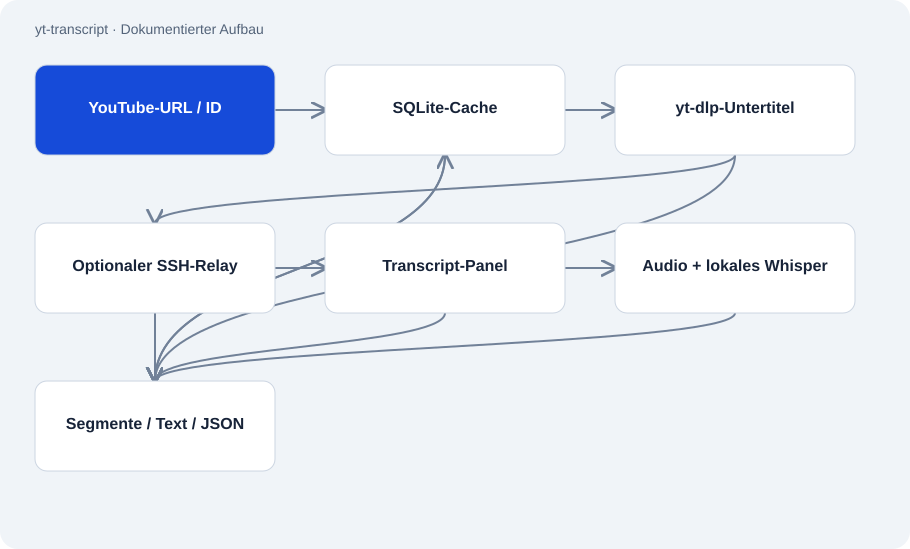

# yt-transcript

Öffentlich · Werkzeug · 2026-11-02

Kommandozeilenwerkzeug für YouTube-Transkripte mit vier Fallbacks. Es versucht zunächst vorhandene Untertitel und nutzt lokale Spracherkennung zuletzt. Ergebnisse landen als Text oder JSON auf stdout und optional im SQLite-Cache.

## Zweck

Fehlende Antworten eines Untertitel-Endpunkts bedeuten nicht immer, dass ein Video keine Untertitel hat. Das Skript unterscheidet mehrere Zugangswege und fällt bei Fehlern weiter, ohne einen Server oder dauerhaften Dienst zu benötigen.



## Funktionen

- yt-dlp-Untertitel, optionaler SSH-Relay, Transcript-Panel und Audio/Whisper.
- Cache trennt Video, Sprache, Quelle, Ausgabeformat und Zeitstempeloption.
- Entfernt unmittelbar wiederholte Untertitelsegmente.
- Validiert URLs/Video-IDs und verwendet Argumentlisten für lokale Unterprozesse.

## Aufbau

- Ein Python-Skript enthält Auswahl, Download, Parser und Cache. yt-dlp wird als Unterprozess angesprochen.
- Der Relay-Pfad setzt eine bereits eingerichtete SSH-Verbindung voraus und bleibt ohne YT_RELAY_HOST aus. Whisper braucht zusätzliche Bibliotheken und lokale Rechenzeit.
- Tests konzentrieren sich laut README auf Eingabegrenzen und Segmentverarbeitung; die vier Netzpfade sind dort nicht unitgetestet.

## Stand und Grenzen

- YouTube-Endpunkte, Cookies und lokale Werkzeuge können ausfallen. Die Fallbacks garantieren kein Transkript.
- Lokale Spracherkennung ist langsamer und kann Fehler enthalten. Sprachwahl übersetzt keine Inhalte.
- Die README-Beispielflags --format und --timestamps passen nicht zum aktuellen Parser; dieser nutzt --text und --no-ts.
- Keine Umgehung von Mitglieder- oder Altersbeschränkungen und keine veröffentlichten bezahlten Provider-Fallbacks.

## Einstieg

Dokumentiertes Aufrufmuster. VIDEO_ID durch eine gültige elfstellige ID ersetzen; Python und yt-dlp vorher einrichten.

```sh
python scripts/yt_transcript.py "https://youtu.be/VIDEO_ID"
```

Nach Einrichtung der Testabhängigkeiten im Repository ausführen.

```sh
python -m pytest
```

## Wichtige Dateien

- `scripts/yt_transcript.py`: Vier Zugangswege, Ausgabe und Cache.
- `tests/test_input_validation.py`: Dokumentierte Eingabe- und URL-Tests.
- `tests/test_segments.py`: Dokumentierte Segment- und Ausgabetests.

## Belege

README und vollständiges Hauptskript am 02.11.2026 gelesen. Netzpfade und Transkriptqualität wurden nicht getestet; das Fallback-Diagramm zeigt die im Code beobachtete Reihenfolge.

- [README.md](https://github.com/Atakan-24/yt-transcript/blob/main/README.md)
- [scripts/yt_transcript.py](https://github.com/Atakan-24/yt-transcript/blob/main/scripts/yt_transcript.py)

## Bilder und Demos

Die Struktur-Grafik oben stellt den belegten Aufbau dar; es wird kein laufendes UI vorgetäuscht.
