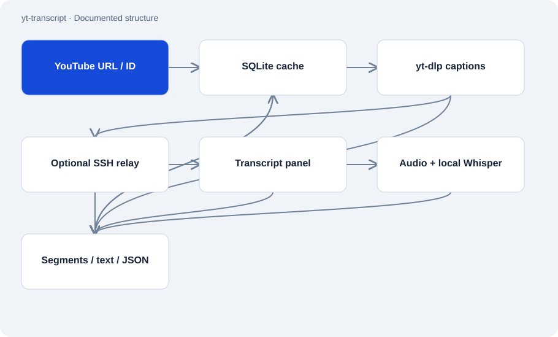

# yt-transcript

Public · Tool · 2026-11-02

Command-line tool for YouTube transcripts with four fallback paths. It first tries existing captions and uses local speech recognition last. Results go to stdout as text or JSON and can be cached in SQLite.

## Purpose

A missing caption response does not always mean a video has no captions. The script tries several access paths and falls back after errors without requiring a server or persistent service.



## Features

- yt-dlp captions, optional SSH relay, transcript panel and audio/Whisper.
- Cache separates video, language, source, output format and timestamp choice.
- Collapses immediately repeated caption segments.
- Validates URLs/video IDs and uses argument lists for local subprocesses.

## Structure

- One Python script contains selection, downloading, parsers and caching. It invokes yt-dlp as a subprocess.
- The relay path requires an existing SSH setup and stays off without YT_RELAY_HOST. Whisper needs extra libraries and local compute time.
- The README describes tests for input boundaries and segment processing; the four network paths are not unit-tested there.

## Status and limits

- YouTube endpoints, cookies and local tools can fail. Fallbacks do not guarantee a transcript.
- Local recognition is slower and can contain errors. Language selection does not translate content.
- The README example flags --format and --timestamps do not match the current parser; it uses --text and --no-ts.
- It does not bypass membership or age restrictions and includes no published paid-provider fallbacks.

## Getting started

Documented invocation pattern. Replace VIDEO_ID with a valid eleven-character ID; configure Python and yt-dlp first.

```sh
python scripts/yt_transcript.py "https://youtu.be/VIDEO_ID"
```

Run in the repository after setting up test dependencies.

```sh
python -m pytest
```

## Key files

- `scripts/yt_transcript.py`: Four access paths, output and cache.
- `tests/test_input_validation.py`: Documented input and URL tests.
- `tests/test_segments.py`: Documented segment and output tests.

## Sources

Read the README and full main script on 2 November 2026. Network paths and transcript quality were not tested; the fallback diagram follows the observed source order.

- [README.md](https://github.com/Atakan-24/yt-transcript/blob/main/README.md)
- [scripts/yt_transcript.py](https://github.com/Atakan-24/yt-transcript/blob/main/scripts/yt_transcript.py)

## Images and demos

The structure diagram above presents the evidenced components; it does not pretend to show a running UI.
